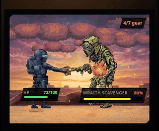
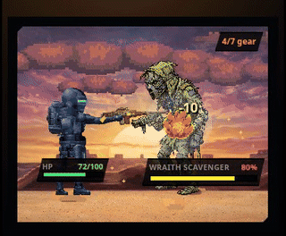

# CyberCache performance and displayed-number audit

Audited **2026-11-12**, against `master` at `1aa4c5de3328782fb5ef6c76e8b0c39ef1a36d0c`.
Scope: interaction performance, Home presentation, numerical provenance and
foreground reward bounds. UI changes are governed by `DESIGN.md`; runtime
ownership is governed by `docs/ARCHITECTURE.md`.

## Findings repaired in this branch

| ID | Impact | Finding and repair | Primary evidence |
| --- | --- | --- | --- |
| F01 | High | Kept-alive Home continued rendering under Gear, Market and Hunter. A shared presentation-visibility signal now pauses Pixi tickers, DOM stage drivers and display clocks; Home also observes whether its stage is on screen. The scene stays mounted. | Real browser draw-call instrumentation; `presentationActivity.test.tsx` |
| F02 | High | Roam actors held recoil/hit poses until another event, and repeated events of the same kind did not re-arm skeletal transitions. Both renderers now recover their poses using the existing movement constants. Pixi caches pose geometry instead of rebuilding the full hunter layout on each approach frame. | Before/after fixture recordings; `roamPoseRecovery.test.ts` |
| F03 | High | The summary subscribed to entire player/loadout/skill/survival stores and rebuilt on every clock second, HP hit and credit update. It also built the mechanics snapshot twice. Subscriptions now select actual stat inputs, preserve unchanged buff/equipment references, and reuse one snapshot. The equip comparison also reuses its snapshots. | `statSummaryMemoization.test.tsx`, red on master |
| F04 | High | The assembly already supplied simulator DPS, but the headline DPS metric still used a separate approximation. Home and boss-picker headline DPS now consume the simulator override when supplied. | `displayNumberAudit.test.ts`; revised boss-picker parity fixture |
| F05 | High | Dmg/tick multiplied standard comparison DPS, whereas roaming settles a different pool including wave/break/ordnance terms. The snapshot now calls the same `computeEffectiveDpsFromGear` helper as the Chef, with effective skill points and Cache Rank. The cell and its sheet use that roaming input. | Audit fixture: **2,028 → 5,476** standing damage per tick |
| F06 | High | Source rows were independently recomputed, omitted Cache Rank, ignored simulator corrections and mixed consumable percentages with raw damage. Core breakdowns now consume snapshot contributions; standing DPS and HP explicitly include their Cache Rank rows. Unpriced percentage potential is no longer an additive damage row. | Audit fixture: HP total **3,053**, old source sum **2,863**, corrected sum **3,053**; core-source sum invariant tests |
| F07 | Medium | Area rate cells partially applied skill bonuses while omitting gear, vehicles, Cache Rank and hot-area factors. They now state **Base** and show the actual starting area rates. Settled rewards remain in the feed. | Home/area-picker walkthrough and source trace into `chef.ts` |
| F08 | Medium | The elapsed display multiplied an already-second-based clock by three. It now derives wall time from the activity's server start and recovers after timer throttling. The consumable ledger also used a frozen mount timestamp; it now uses the shared live clock. | **1 real second: 3s → 1s**; minute rollover and clock-jump tests |
| F09 | Medium | Extra queue/listing slots printed as percentages, e.g. two slots as `+200%`. Formatting now follows the content definition's unit. Headline selection uses metric keys rather than fragile array positions. | Count-format and headline-identity regression |
| F10 | High | The foreground route spread the request body into an engine request, including the internal `maxTicks` option. A caller could expand the foreground processing budget. The route now strips that option and rejects malformed tick counters. | Local HTTP fixture processed **100 ticks on master**, **20 after repair**; five malformed-counter cases change **200 → 400** |
| F11 | Medium | Vite development pages evaluated named imports from the browser's `node:zlib` stub and could boot blank. The Node-only PNG codec now defers property access until an actual codec call. Node rendering still uses the real synchronous codec. | Reproduced blank development harness; working real harness after repair; build/type checks |

F05 is a standing-build expectation before target defense, random variance and
temporary combat effects. It is not a promise that each landed hit equals the
display. F06 reconciles the displayed quantities; it does not redefine combat
balance or replace the simulator.

## Motion review

The fixture drives the real Home roam stage through repeated shots, a crit,
an enemy answer and a target change. At roughly 1.2 seconds after an event,
the old probe still reports `recoil`/`hit`; the repaired probe reports `aim`.
The same scene, art and approach placement are retained. The boss phase,
420 ms hit FX, loot ladder and reward clocks are unchanged.

| Before | After |
| --- | --- |
|  |  |

These are software-rendered browser fixtures sampled into GIFs, **not phone
FPS benchmarks**. They demonstrate choreography and recovery. The draft PR
is the review point for the visual change.

The [browser evidence](2026-11-12-evidence/browser-checks.json) records zero
stage draws while Gear, Market and Hunter are open, zero while the stage is
scrolled away, and the **same canvas identity** on every return. Visible Home
resumes drawing. The walkthrough reported no uncaught application errors;
one claim received the existing 409 tick-watermark response. The refreshed
Home orientation plate is in `wiki/images/ui/home-stage.png`.

## Open work respected

The open PR list was checked twice during the audit:

| PR | Existing work | This branch's boundary |
| --- | --- | --- |
| [#553](https://github.com/michaelhmiv/CyberCache/pull/553) | Primary-weapon + skill-node crit display | Crit composition is untouched. Shared files overlap in summary assembly, hero cells and the wiki; retain both changes when integrating. |
| [#554](https://github.com/michaelhmiv/CyberCache/pull/554) | Deferrable username prompt | App/auth/prompt code is untouched. |
| [#555](https://github.com/michaelhmiv/CyberCache/pull/555) | Canonical HP pool and Thick Skin wiring | HP formulas and roaming/offline pool wiring are untouched. The snapshot gains a separate roaming-DPS quantity; summary source rows expose the already-existing HP bonus. Retain #555's canonical helper refactor. |

No existing PR was merged, closed or edited. This branch does not supersede
those fixes. In particular, its green tests do not establish that the pending
crit/HP changes have shipped. Test the combined tree after integration.

## Remaining findings and decisions

### R01 — High: complete foreground authority still needs its own change

F10 closes a concrete processing-cap bypass. It does **not** establish an
authoritative elapsed-time budget or authoritative survival state.

`src/server/routes/roamingHandler.ts` still starts from a body spread and
passes client survival/kill-cycle state through to the engine. In
`src/server/chef.ts`, roaming reads `request.survival.currentHp/maxHp`.
The final `cc_apply_chef_rewards` definition in
`db/migrations/0082_cache_lane_rebuild.sql` checks the monotonic tick watermark,
but has no elapsed-time allowance check; a missing/mismatched roaming action
raises a warning and proceeds. The separate offline route does derive elapsed
time from server timestamps.

Next repair: enforce the foreground time allowance atomically with payment,
require the correct active action, and derive/clamp survival from canonical
server facts. Coordinate the HP portion with #555. Do not bolt a client timer
onto this boundary: it would not establish authority. These are confirmed
code paths; this audit did not send forged requests to production.

### R02 — Medium: research-earned offline cap can stay stale

`useOfflineCapHours.ts` fetches Research bonuses once in a mount-only effect.
Home now survives tab switches, while Research owns a different local copy.
Completing research can therefore leave Home's Away cap stale until remount.
This was identified from the read/update paths; a real multi-hour course was
not completed during the guest walkthrough. Use one refreshed Research read
model for Home, Settings and the Research panel.

### R03 — Product decision: inventory healing in Effective HP

The current summary intentionally includes unused Med Kit healing potential.
At level 1, twelve Med Kits add **1,824** to Effective HP before any is used,
while Home's actual pool remains **760** without other equipment. Existing
tests explicitly require this behavior. A question was raised with the owner:
should current stats include only equipped/active confirmed effects, with
unused consumables described as potential in the belt? That definition is
left unchanged here, independently of #555's raw-pool repair.

### R04 — Medium: startup and native performance need further measurement

The final client build still contains substantial shared chunks:
`PxIcon` about **850 kB**, the sprite manifest about **748 kB**, and
`PixelWeapon` about **422 kB**, before compression. Lazy tab loading and
inventory windowing already landed before this branch; they were not
reimplemented. Next investigate which shared art/registry code is needed on
first paint, then measure cold/warm navigation on the target Android WebView
and a large real inventory. Avoid changing the approved art to hit an
unmeasured bundle-size target.

## Verification and limits

- Baseline: **434 files / 4,751 tests passed** on untouched master.
- New numerical/memoization regressions were copied into an isolated master
  worktree: all four original cases failed on behavior, including the
  190-HP source gap and 2,028-vs-5,476 damage discrepancy.
- The six foreground HTTP bounds cases also all failed on master and pass
  after the route repair. These run only against an in-memory local server.
- Targeted existing stat, renderer, travel and work-cycle suites passed
  (**113 tests**). Old tests that pinned incorrect timer scaling, mixed-unit
  source rows or an unsafe absence of `maxTicks` handling were corrected.
- Final full suite: **439 files / 4,770 tests passed**. Two historical source-string assertions initially rejected the new explicit request-cap handling; both were updated, their 46-test pair passed, and the complete suite was rerun successfully.
- Build and all three TypeScript configurations pass. Lint has no errors;
  the existing `useWindowedList.ts` dependency warning remains.
- Architecture guard passes with **0 violations**. Generated wiki tables
  and all **289 generated image plates** match their sources; the shallow
  checkout skips only the changelog-history tripwire, which CI runs full-depth.
- Browser coverage: 412 px Home, roaming, Gear, Market, Hunter and returns;
  source and loadout data were inspected using test guest accounts. All
  upstream requests used the environment's configured TLS trust. The local
  build was previewed with the real backend; nothing was deployed.
- This was not an authenticated owner-inventory test, physical Android GPU
  benchmark, live Postgres migration drill or proof that every displayed
  number is now correct. R01–R04 and the three open PRs remain explicit.

## Rules for subsequent work

Keep gameplay math in its existing owner and make display adapters consume
its result. Require matching units and source sums for additive breakdowns.
Test the public quantity the screen actually prints, including its context
and slot identity. Use behavioral HTTP checks at trust boundaries rather
than source-string absence checks. Keep visibility strictly a presentation
concern. Add new caches or fallback quantities only with a named owner and
a demonstrated need; do not create another screen-local approximation.
