# Reference — Areas

The seven roaming areas, pictured in the paintings the game itself
opens on, with the facts a runner plans around: what hunts there,
what the ground is known for, and the named elite whose territory it
is. See [[Actions and Occupations]] for how roaming works, and the
areas table in [[Reference]] for the baseline earning rates behind
these pages.

<!-- GENERATED from src/constants/roamingAreas.ts, src/content/areaPalettes.ts, src/lib/pixel/manifest.ts, src/lib/pixel/paletteSwap.ts, src/constants/monsters.ts — do not edit by hand -->
<!-- wiki-gen:areas-pictured -->
Every roaming area, pictured in its own backdrop painting — the art the Action stage opens on (in game the stage also stacks the zone's parallax re-cuts over the painting and drifts them; the painting is the plate). Facts are the area's own: what hunts there, what it is known for, and the elite whose name it answers to. Baseline earning rates live in the areas table in [[Reference]].

### Dustwaste Frontier

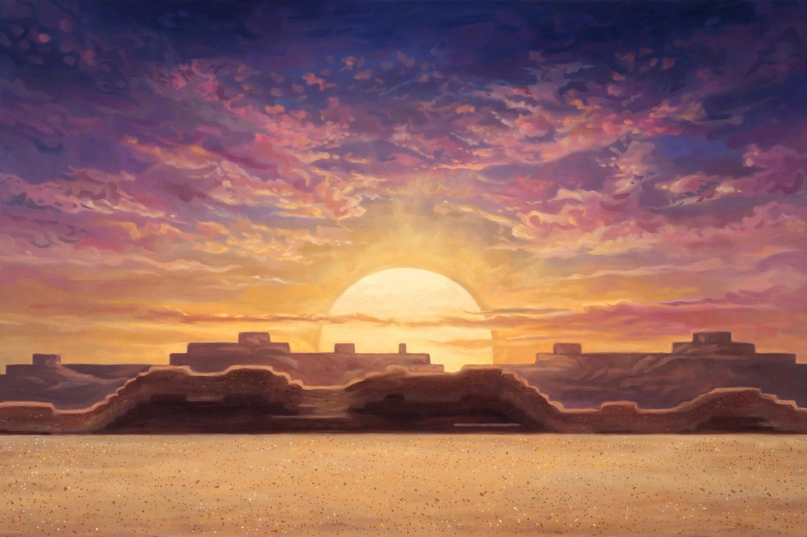

Open scrapland routes where new runners learn the roaming loop.

- **Danger:** Low · **Enemies:** Raiders, scrap drones, and scavengers
- **Signature materials:** Scrap, Ballistic Parts · **Signature loot:** Balanced gear, early salvage
- **Influence:** Mixed · **Named elite:** Silt Marshal
- Need general early loot? Stay in Dustwaste Frontier.

### Redline Circuit

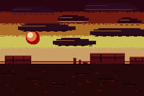

Burned highway loops owned by speed crews and pursuit drones.

- **Danger:** Medium · **Enemies:** Fast raiders, pursuit drones, and overheating runners
- **Signature materials:** Scrap, Ballistic Parts · **Signature loot:** SMGs, pistols, attack speed, reload and ramp affixes
- **Influence:** Redline · **Named elite:** Pursuit Prime
- Need speed farming gear? Roam Redline Circuit.

### Ironwood Bastion

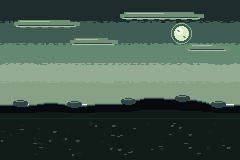

Fortified ridge posts where precision crews hold long sightlines.

- **Danger:** Medium/High · **Enemies:** Marksmen, armored captains, and sentry posts
- **Signature materials:** Ballistic Parts, Tech · **Signature loot:** Snipers, pistols, crit rolls, weakpoint and boss-damage flavor
- **Influence:** Ironwood · **Named elite:** Thornwarden
- Need better crit or boss weapons? Roam Ironwood Bastion.

### BlastForge Yards

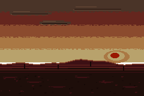

Industrial breaker yards packed with refinery bots and live ordnance.

- **Danger:** Medium/High · **Enemies:** Armored machines, refinery bots, and demolition crews
- **Signature materials:** Scrap, Ballistic Parts, Reactive Components, Ignition Fluid · **Signature loot:** Launchers, shotguns, armor break, stagger and explosive flavor
- **Influence:** BlastForge · **Named elite:** Slag Herald
- Need armor-breaking materials? Roam BlastForge Yards.

### Prismatek Reactor

A leaking test reactor where elemental anomalies rewrite the battlefield.

- **Danger:** Variable · **Enemies:** Elemental anomalies, shielded test subjects, and reactor constructs
- **Signature materials:** Tech, Ignition Fluid, Conduit Wire, Acid Compound, Cryo Gel, Void Essence · **Signature loot:** Beams, elemental weapons, status affixes, weakness exploitation
- **Influence:** Prismatek · **Named elite:** Phase Revenant
- Need elemental essences? Roam Prismatek Reactor.

### ThrowTech Dumpnet

A hacked junk-grid of turret nests, signal traps, and cheap disposable tech.

- **Danger:** Medium · **Enemies:** Hacked drones, turret nests, minefields, and signal traps
- **Signature materials:** Tech, Reactive Components, Conduit Wire · **Signature loot:** Deployable-flavored gear, ordnance, utility drops, drone parts
- **Influence:** ThrowTech · **Named elite:** Heap Warden
- Need utility tech and deployable flavor? Roam ThrowTech Dumpnet.

### HelixWorks Labyrinth

A shifting prototype complex where modular test rigs rebuild themselves.

- **Danger:** High · **Enemies:** Prototype constructs, unstable test rigs, and shifting lab defenses
- **Signature materials:** Tech, Void Dust, Scrap, Reactive Components, Void Essence · **Signature loot:** HelixWorks gear, higher roll quality flavor, modular parts
- **Influence:** HelixWorks · **Named elite:** Specimen Zero
- Need modular crafting depth? Roam HelixWorks Labyrinth.

### Who hunts here — the enemy families

Five families cover every roaming encounter; an area's wildlife is these frames re-hued in the area's own palette. Bosses are not a family — each wears its own bespoke art (see [[Reference-Bosses]]).

| Plate | Family |
| --- | --- |
| 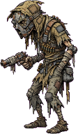 | **Fodder** |
| 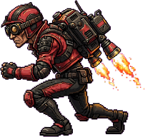 | **Runner** |
| 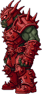 | **Brute** |
| 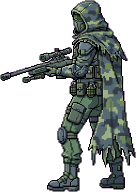 | **Sniper** |
|  | **Elite** |

### The named elites

One named elite haunts each area. Only the Silt Marshal has bespoke art; the rest are the elite frame re-hued by their area's enemy palette — the same swap the stage applies, rendered here so the wiki shows the elite you actually meet.

| Plate | Elite | Area |
| --- | --- | --- |
| 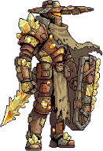 | **Silt Marshal** | Dustwaste Frontier |
| 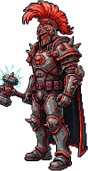 | **Pursuit Prime** | Redline Circuit |
| 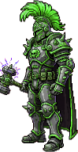 | **Thornwarden** | Ironwood Bastion |
| 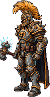 | **Slag Herald** | BlastForge Yards |
| 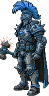 | **Phase Revenant** | Prismatek Reactor |
|  | **Heap Warden** | ThrowTech Dumpnet |
| 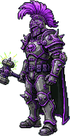 | **Specimen Zero** | HelixWorks Labyrinth |
<!-- /wiki-gen:areas-pictured -->

---

_Source of truth: `src/constants/roamingAreas.ts`, `src/content/areaPalettes.ts` — rendered by `scripts/wiki-gen/`. Last synced from the repo `wiki/` directory — see `.sync-sha` for the master commit this page was published from._
