# Reference — Bosses

The full boss roster, as **intel**: the same facts the boss prep
screen shows you before an attempt — stats, mechanics,
phases, and the counters the game itself recommends. See [[Bosses]]
for how attempts, rematches, and resurrection work.

Consistent with the game's own prep screens, this page prints no
drop odds, no win chances, and no pity numbers. Each boss's
*dedicated* drops — the effects that boss is known for — are named,
because prep and [[Collections]] both name them; the general effect
pool a boss draws from is not printed.

<!-- GENERATED from src/constants/bosses.ts, src/content/areaPalettes.ts, src/lib/pixel/manifest.ts — do not edit by hand -->
<!-- wiki-gen:bosses -->
### Dune Tyrant — Tier 1

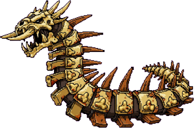

- **Boss level:** 5 · **Recommended power:** 120
- **Health / Shield / Armor:** 800 / 0 / 0 · **Boss DPS:** 30
- **Weaknesses:** Kinetic · **Resistances:** —
- **Mechanic — No Special Mechanic:** Tutorial boss. No special requirement.
- **Attack pattern:** hits every 6s; special **Sand Slam** every 18s after a 3s wind-up, carrying ~35% of its damage
- **Entry / rematch:** 0 cr / 100 cr
- **Dedicated drops:** Debt Collector, Warranty Void

**Phases**

- **Basic Boss Read** (survival check) — A simple opening check that teaches boss attempts without a hard counter requirement. Counters: basic weapon damage, Med Kit, Shield Cell.

**The arena** — every boss fights on its own ground:

### The Siltstalker — Tier 2

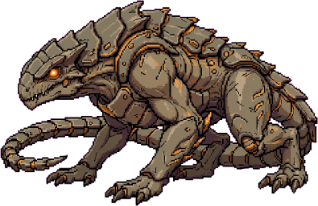

- **Boss level:** 10 · **Recommended power:** 300
- **Health / Shield / Armor:** 1500 / 500 / 0 · **Boss DPS:** 55
- **Weaknesses:** Fire · **Resistances:** Cryo
- **Mechanic — Enrage Protocol:** Boss enrages at 50% HP, doubling damage. Needs high DPS to finish fast.
- **Attack pattern:** hits every 4s; special **Enrage Surge** every 12s after a 3s wind-up, carrying ~30% of its damage
- **Entry / rematch:** 200 cr / 300 cr
- **Dedicated drops:** Bad Decision, Glass Sun

**Phases**

- **Opening Burn** (dps check) — Build enough damage before the boss reaches the enrage window. Counters: Fire weapon, high DPS weapon, Target Painter, Void Ammo.
- **50% Enrage Window** (dps check) — At half health, the boss spikes damage unless burst or control answers it. Counters: Cryo Ammo, Jammer, Target Painter, high crit/burst weapon.

**The arena** — every boss fights on its own ground:

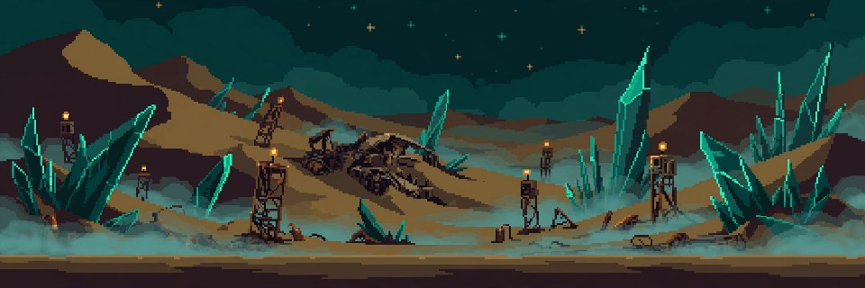

### Gromm, the Heap Guard — Tier 3

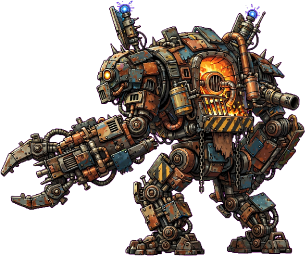

- **Boss level:** 15 · **Recommended power:** 550
- **Health / Shield / Armor:** 2000 / 1200 / 0 · **Boss DPS:** 70
- **Weaknesses:** Shock · **Resistances:** Fire
- **Mechanic — Rapid Shield Regen:** Shield regenerates quickly if not broken within 15s.
- **Attack pattern:** hits every 5s; special **Aegis Slam** every 15s after a 3s wind-up, carrying ~30% of its damage
- **Entry / rematch:** 400 cr / 500 cr
- **Dedicated drops:** Ricochet Gospel, Thunder Receipt

**Phases**

- **Shield Regen Loop** (shieldBreak check) — Break the shield quickly or the boss regenerates it and stalls the fight. Counters: Shock weapon, Shock Ammo, Ordnance Charge, Jammer.

**The arena** — every boss fights on its own ground:

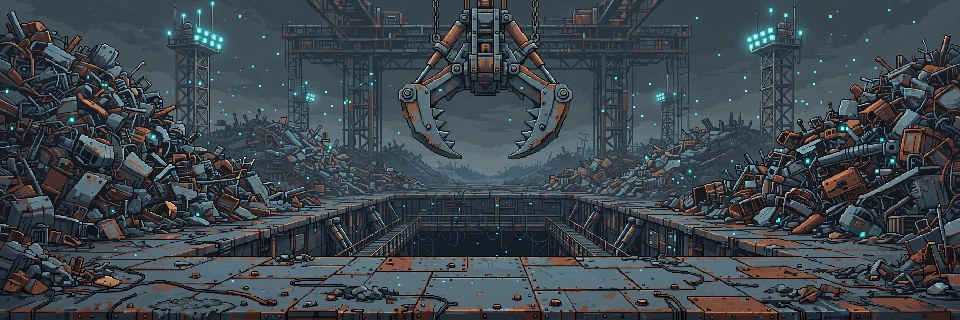

### Ashgut — Tier 4

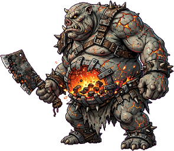

- **Boss level:** 22 · **Recommended power:** 900
- **Health / Shield / Armor:** 3500 / 0 / 800 · **Boss DPS:** 95
- **Weaknesses:** Corrosive · **Resistances:** Fire
- **Mechanic — Burning Ground:** Leaves burning ground; survival check is harder.
- **Attack pattern:** hits every 3s; special **Eruption** every 15s after a 3s wind-up, carrying ~25% of its damage
- **Entry / rematch:** 600 cr / 700 cr
- **Dedicated drops:** Salvage Rights, Overclocked

**Phases**

- **Burning Ground Attrition** (survival check) — Damage-over-time pressure raises the survival requirement across the fight. Counters: Med Kit, Shield Cell, Nano Swarm, survival gear.

**The arena** — every boss fights on its own ground:

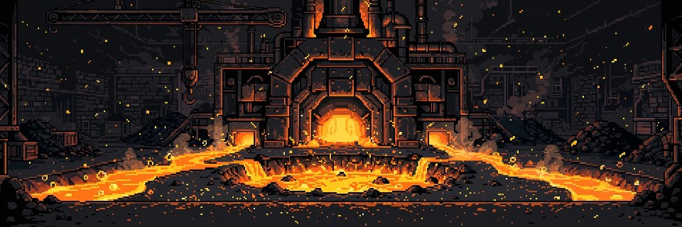

### The Mirage Duster — Tier 5

- **Boss level:** 28 · **Recommended power:** 1400
- **Health / Shield / Armor:** 5000 / 1500 / 0 · **Boss DPS:** 110
- **Weaknesses:** Shock · **Resistances:** Kinetic
- **Mechanic — Phase Out:** Boss phases out periodically. Needs Stagger or Scanner to pin.
- **Attack pattern:** hits every 6s; special **Mirage Flurry** every 15s after a 3s wind-up, carrying ~45% of its damage
- **Entry / rematch:** 1000 cr / 1200 cr
- **Dedicated drops:** Borrowed Time, Kickback

**Phases**

- **Pin the Mirage** (mechanic check) — The boss phases out unless scanner, control, or stagger effects keep it targetable. Counters: Boss Scanner, Cryo Ammo, Jammer, stagger effects.
- **Mirage Shield** (shieldBreak check) — A lighter shield check still rewards Shock support. Counters: Shock weapon, Shock Ammo, Ordnance Charge.

**The arena** — every boss fights on its own ground:

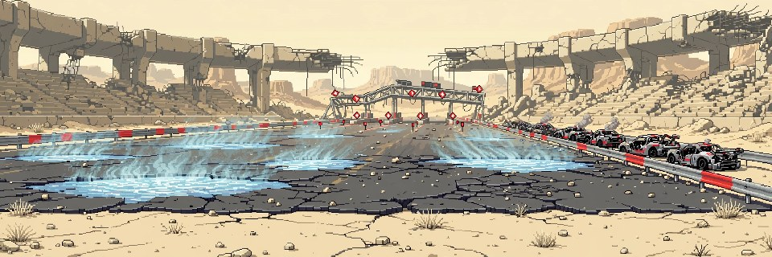

### The Rust Prophet — Tier 6

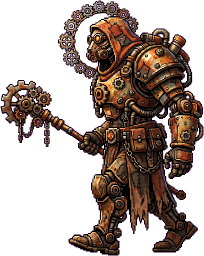

- **Boss level:** 35 · **Recommended power:** 2000
- **Health / Shield / Armor:** 6000 / 0 / 2500 · **Boss DPS:** 130
- **Weaknesses:** Corrosive · **Resistances:** Shock
- **Mechanic — Heavy Repair:** Heavy armor repair. Needs Anti-Heal or Armor Break.
- **Attack pattern:** hits every 6s; special **Prophet's Hammer** every 18s after a 3s wind-up, carrying ~40% of its damage
- **Entry / rematch:** 1500 cr / 1800 cr
- **Dedicated drops:** Vampiric Ledger, Echo Chamber

**Phases**

- **Armor Repair Phase** (armorBreak check) — The boss repairs armor faster than weak armor break can remove it. Counters: Corrosive weapon, Corrosive Ammo, Armor-Piercing Ammo, Phase Shift Grenade.

**The arena** — every boss fights on its own ground:

### Scrap Bishop — Tier 7

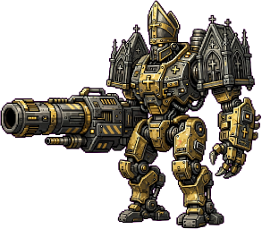

- **Boss level:** 45 · **Recommended power:** 3200
- **Health / Shield / Armor:** 10000 / 3000 / 4000 · **Boss DPS:** 180
- **Weaknesses:** Corrosive · **Resistances:** Fire
- **Mechanic — Three-Phase Siege:** Shield -> Armor -> Enrage. Must break each layer.
- **Attack pattern:** hits every 5s; special **Siege Barrage** every 15s after a 3s wind-up, carrying ~35% of its damage
- **Entry / rematch:** 2500 cr / 3000 cr
- **Dedicated drops:** Chain Lightning, Void Bargain, Jackpot

**Phases**

- **Siege Shield Phase** (shieldBreak check) — Shock or ordnance support is needed to clear the opening shield cleanly. Counters: Shock weapon, Shock Ammo, Ordnance Charge.
- **Siege Armor Phase** (armorBreak check) — Corrosive or armor-break tools are needed after the shield drops. Counters: Corrosive weapon, Corrosive Ammo, BlastForge heavy weapon, Ordnance Charge.
- **Final Enrage** (dps check) — The final phase rewards burst damage, survival margin, or control. Counters: high DPS weapon, Target Painter, Cryo Ammo, Shield Cell.

**The arena** — every boss fights on its own ground:

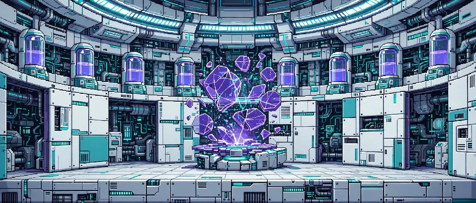

### Widow-9, the Spinneret — Tier 8

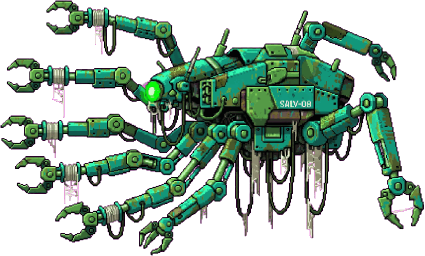

- **Boss level:** 50 · **Recommended power:** 4600
- **Health / Shield / Armor:** 14000 / 2500 / 1500 · **Boss DPS:** 215
- **Weaknesses:** Fire · **Resistances:** Shock
- **Mechanic — Spinneret Overclock:** Her loom-arms spin faster the longer the fight runs: boss damage ramps up with time-to-kill. Burst her down — a slow fight is a losing fight.
- **Attack pattern:** hits every 3s; special **Web Nova** every 12s after a 3s wind-up, carrying ~30% of its damage
- **Entry / rematch:** 3500 cr / 4200 cr
- **Dedicated drops:** Hot Swapper, Echo Chamber

**Phases**

- **Thread the Loom** (dps check) — Open hard before the loom-arms reach full spin. Counters: high DPS weapon, Target Painter, Ammo Pack.
- **Overclock Window** (dps check) — Every second the fight drags, her strike tempo — and damage — climbs. Counters: burst weapon, Ironwood crit build, Adrenaline Shot.
- **Web Snare** (survival check) — Filament snares tax your survival while the arms keep spinning. Counters: Med Kit, Shield Cell, Nano Swarm.

**The arena** — every boss fights on its own ground:

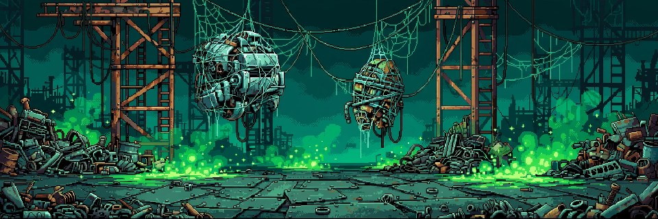

### The Mnemosyne Mirror — Tier 9

- **Boss level:** 55 · **Recommended power:** 6400
- **Health / Shield / Armor:** 19000 / 6000 / 0 · **Boss DPS:** 255
- **Weaknesses:** Kinetic · **Resistances:** Cryo
- **Mechanic — Adaptive Plating:** The Mirror attunes to your primary weapon: its element is struck from her weaknesses and read as resisted. Carry a second answer — sidearms and heavies keep their bite.
- **Attack pattern:** hits every 5s; special **Refraction Burst** every 15s after a 3s wind-up, carrying ~40% of its damage
- **Entry / rematch:** 5000 cr / 6000 cr
- **Dedicated drops:** Phase Shifter, Stable Loop

**Phases**

- **Mirror Shield** (shieldBreak check) — A heavy reflective shield fronts the construct. Counters: Shock weapon, Shock Ammo, Ordnance Charge.
- **Attunement** (mechanic check) — She reads your primary and re-plates against it. Mixed elements keep a real answer live. Counters: mixed-element loadout, Hot Swapper secondary, Boss Scanner.
- **Refraction Burst** (survival check) — Stored light returns as burst damage through the late fight. Counters: Shield Cell, Med Kit, Nano Swarm.

**The arena** — every boss fights on its own ground:

### The Static Choir — Tier 10

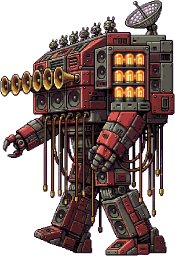

- **Boss level:** 60 · **Recommended power:** 8800
- **Health / Shield / Armor:** 26000 / 0 / 3000 · **Boss DPS:** 300
- **Weaknesses:** Cryo · **Resistances:** Fire
- **Mechanic — Harmonic Shroud:** A chord of interference bends incoming fire off-beat. Stagger breaks the harmony — bring stagger chance (Demolition tree) or the fight drags at half effect.
- **Attack pattern:** hits every 4s; special **Feedback Wail** every 12s after a 3s wind-up, carrying ~35% of its damage
- **Entry / rematch:** 7000 cr / 8400 cr
- **Dedicated drops:** Chain Lightning, Cryo Stasis

**Phases**

- **Break the Chord** (mechanic check) — The shroud holds until stagger interrupts the harmony. Counters: stagger effects, Concussion skills, Cryo Ammo.
- **Amplifier Armor** (armorBreak check) — Ribbed amplifier plating shrugs off weak armor break. Counters: Corrosive weapon, Armor-Piercing Ammo, Ordnance Charge.
- **Feedback Wail** (survival check) — The full choir answers with a survival-taxing feedback wail. Counters: Med Kit, Shield Cell, Nano Swarm.

**The arena** — every boss fights on its own ground:

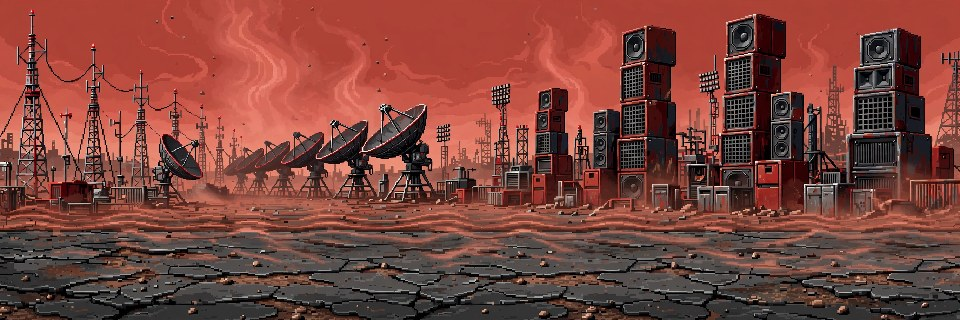

### The Verdant Maw — Tier 11

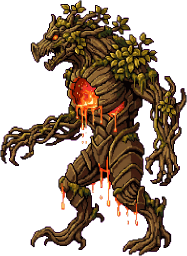

- **Boss level:** 65 · **Recommended power:** 12000
- **Health / Shield / Armor:** 35000 / 0 / 9000 · **Boss DPS:** 355
- **Weaknesses:** Fire · **Resistances:** Cryo
- **Mechanic — Living Armor:** Heartwood plating regrows as fast as it cracks. Sustained armor break — Corrosive and Ordnance — or the Maw simply out-grows your damage.
- **Attack pattern:** hits every 6s; special **The Maw Opens** every 20s after a 3s wind-up, carrying ~45% of its damage
- **Entry / rematch:** 9500 cr / 11500 cr
- **Dedicated drops:** Molten Core, Salvage Rights

**Phases**

- **Heartwood Plating** (armorBreak check) — The armor check is the fight: crack the plating faster than it regrows. Counters: Corrosive weapon, Corrosive Ammo, Phase Shift Grenade, BlastForge heavy weapon.
- **Burning Sap** (survival check) — Cracked plating weeps burning sap — attrition pressure for the whole fight. Counters: Med Kit, Nano Swarm, Shield Cell.
- **The Maw Opens** (dps check) — With the plating down, burn the furnace heart before it reseals. Counters: Fire weapon, Incendiary Ammo, Target Painter.

**The arena** — every boss fights on its own ground:

### Sister Null, the Void Anchor — Tier 12

- **Boss level:** 70 · **Recommended power:** 16500
- **Health / Shield / Armor:** 47000 / 3500 / 0 · **Boss DPS:** 415
- **Weaknesses:** Void · **Resistances:** Kinetic
- **Mechanic — Rift Anchor:** She anchors the fight to a void rift that swallows clean hits. Status pressure collapses the rift — bring status chance (Procedural Loads) or fight at half effect.
- **Attack pattern:** hits every 5s; special **Event Horizon** every 18s after a 3s wind-up, carrying ~40% of its damage
- **Entry / rematch:** 13000 cr / 15500 cr
- **Dedicated drops:** Void Bargain, Jackpot

**Phases**

- **Void Shield** (shieldBreak check) — A thin but real shield wraps the anchor. Counters: Shock weapon, Shock Ammo, Ordnance Charge.
- **Collapse the Rift** (mechanic check) — The rift swallows clean hits until status effects destabilize it. Counters: status effects, elemental ammo, Boss Scanner.
- **Event Horizon** (survival check) — She drags the fight toward the horizon — the survival check of the deep ladder. Counters: Shield Cell, Med Kit, Nano Swarm, Turtle shield.

**The arena** — every boss fights on its own ground:

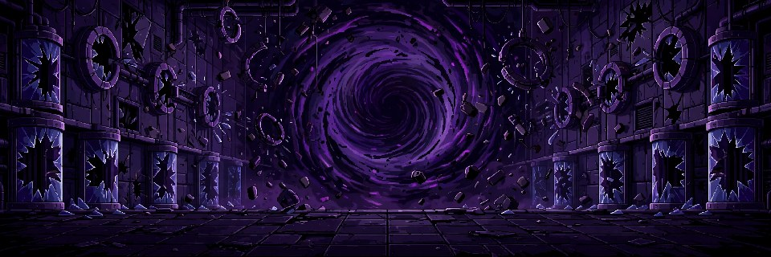

### Vaultkeeper Omega — Tier 13

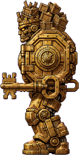

- **Boss level:** 75 · **Recommended power:** 22500
- **Health / Shield / Armor:** 64000 / 8000 / 10000 · **Boss DPS:** 485
- **Weaknesses:** Void · **Resistances:** Fire, Shock
- **Mechanic — Final Overclock:** The Vaultkeeper's core spins up the longer the vault is contested: damage ramps with time-to-kill on top of the siege layers. Break him fast, layer by layer.
- **Attack pattern:** hits every 5s; special **Final Overclock** every 15s after a 3s wind-up, carrying ~35% of its damage
- **Entry / rematch:** 18000 cr / 21000 cr
- **Dedicated drops:** Jackpot, Void Bargain, Chain Lightning

**Phases**

- **Vault Shield Phase** (shieldBreak check) — The vault's shield layer comes first — Shock or ordnance clears it. Counters: Shock weapon, Shock Ammo, Ordnance Charge.
- **Vault Plating Phase** (armorBreak check) — Combination-lock plating demands real armor break. Counters: Corrosive weapon, Corrosive Ammo, BlastForge heavy weapon, Ordnance Charge.
- **Final Overclock** (dps check) — The core spins up: every second left on the clock is damage you will eat. Counters: high DPS weapon, Target Painter, Adrenaline Shot, Cryo Ammo.

**The arena** — every boss fights on its own ground:

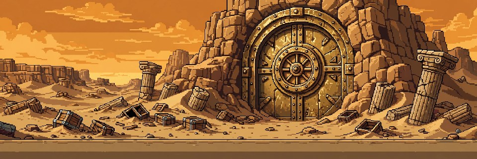
<!-- /wiki-gen:bosses -->

---

_Source of truth: `src/constants/bosses.ts` — rendered by `scripts/wiki-gen/`. Last synced from the repo `wiki/` directory — see `.sync-sha` for the master commit this page was published from._
