# Reference — Consumables

The complete consumables catalog: every type the game ships, what it
does, and where it comes from. See [[Combat]] and [[Crafting]] for
how consumables are used and made.

**Vendor** below follows the shipped stocking flags: *Vendor staple*
means the NPC vendor always stocks it (at a flat 100% quality);
*Vendor rotation* means it appears in the daily rotation; *Crafter-only*
means the vendor never sells it in any channel — it exists only from
crafters and the player market; *Not stocked* means craftable and
tradable, but the vendor doesn't carry it. **Crafted quality range**
is the quality band a crafted batch can roll, against the game's
175% quality cap.

<!-- GENERATED from src/constants/consumables.ts, src/lib/pixel/itemArt.ts, src/assets/pixel/manifest.json, src/constants/visualAssets.ts — do not edit by hand -->
<!-- wiki-gen:consumables -->
| Icon | Consumable | Family | Effect | Price (cr) | Vendor | Crafted quality range |
| --- | --- | --- | --- | --- | --- | --- |
|  | **Med Kit** | Survival | Med Kit consumed: restored emergency HP. | 250 | Vendor staple | 75–125% (cap 175%) |
|  | **Med Kit (Refined)** | Survival | Refined Med Kit consumed: restored heavy emergency HP. | 600 | Not stocked | 80–140% (cap 175%) |
| 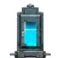 | **Shield Cell** | Survival | Shield Cell consumed: restored shield capacity. | 300 | Vendor staple | 75–130% (cap 175%) |
|  | **Nano Swarm** | Survival | Nano Swarm consumed: deployed repair-over-time cloud. | 800 | Not stocked | 80–145% (cap 175%) |
|  | **Adrenaline Shot** | Survival | Adrenaline Shot consumed: survived a lethal window and gained short DPS. | 1200 | Not stocked | 75–150% (cap 175%) |
| 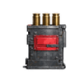 | **Ammo Pack** | Ammo | Ammo Pack consumed: supplied sustained ammunition coverage. | 150 | Vendor staple | 70–125% (cap 175%) |
| 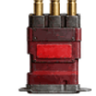 | **High-Capacity Ammo Pack** | Ammo | High-Capacity Ammo Pack consumed: supplied extended ammo coverage. | 375 | Not stocked | 75–140% (cap 175%) |
| 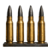 | **Armor-Piercing Ammo** | Ammo | Armor-Piercing Ammo consumed: increased armor-break output. | 400 | Not stocked | 75–135% (cap 175%) |
|  | **Incendiary Ammo** | Ammo | Incendiary Ammo consumed: added burn DPS pressure. | 450 | Not stocked | 75–140% (cap 175%) |
|  | **Shock Ammo** | Ammo | Shock Ammo consumed: increased shield-break output. | 450 | Not stocked | 75–140% (cap 175%) |
|  | **Corrosive Ammo** | Ammo | Corrosive Ammo consumed: increased armor break and repair suppression. | 450 | Not stocked | 75–140% (cap 175%) |
| 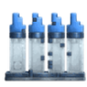 | **Cryo Ammo** | Ammo | Cryo Ammo consumed: reduced incoming enemy pressure. | 450 | Not stocked | 75–140% (cap 175%) |
| 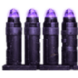 | **Void Ammo** | Corrupted | Void Ammo consumed: increased DPS and reduced survival stability. | 700 | Not stocked | 70–155% (cap 175%) |
|  | **Ordnance Charge** | Ordnance | Ordnance Charge consumed: applied burst break pressure. | 400 | Not stocked | — |
|  | **Ordnance Charge** | Ordnance | Ordnance Charge consumed: applied crafted burst break pressure. | 400 | Vendor staple | 75–145% (cap 175%) |
|  | **EMP Charge** | Ordnance | EMP Charge consumed: broke shield pressure and suppressed mechanical mechanics. | 650 | Not stocked | 75–145% (cap 175%) |
| 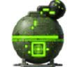 | **Corrosive Charge** | Ordnance | Corrosive Charge consumed: cracked armor and suppressed repair. | 650 | Not stocked | 75–145% (cap 175%) |
|  | **Phase Shift Grenade** | Ordnance | Phase Shift Grenade consumed: bypassed part of the armor phase. | 1000 | Not stocked | 75–155% (cap 175%) |
|  | **Magnetized Payload** | Ordnance | Magnetized Payload consumed: boosted loaded ordnance. | 650 | Not stocked | 75–150% (cap 175%) |
| 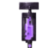 | **Overcharge Stim** | Corrupted | Overcharge Stim consumed: increased short-window DPS. | 800 | Not stocked | 70–150% (cap 175%) |
|  | **Target Painter** | Tactical | Target Painter consumed: marked the boss for focused fire. | 600 | Not stocked | 75–145% (cap 175%) |
| 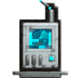 | **Boss Scanner** | Tactical | Boss Scanner consumed: generated boss prep intelligence. | 600 | Vendor staple | 80–160% (cap 175%) |
| 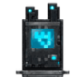 | **Jammer** | Tactical | Jammer consumed: weakened a boss mechanic. | 750 | Not stocked | 75–150% (cap 175%) |
|  | **Signal Scrambler** | Tactical | Signal Scrambler consumed: reduced roaming enemy accuracy. | 500 | Not stocked | 75–145% (cap 175%) |
|  | **Loot Beacon** | Economy | Loot Beacon consumed: increased roaming gear drop chance, event chance, and enemy pressure. | 900 | Not stocked | 70–150% (cap 175%) |
|  | **Insurance Token** | Economy | Insurance Token consumed: reduced defeat death fee. | 800 | Vendor staple | 80–145% (cap 175%) |
| 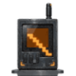 | **Data Skimmer** | Economy | Data Skimmer consumed: attempted an extra victory loot roll; roaming events skew toward finds and the next event is foreshadowed. | 900 | Not stocked | 75–150% (cap 175%) |
|  | **Luck Booster** | Economy | Luck Booster consumed: improved post-success loot chance. | 350 | Vendor staple | 75–135% (cap 175%) |
| 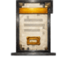 | **Salvage Contract** | Economy | Salvage Contract consumed: increased scrap/material yield. | 700 | Not stocked | 75–150% (cap 175%) |
|  | **Workshop Rush Ticket** | Economy | Workshop Rush Ticket consumed: reduced workshop duration. | 1000 | Vendor rotation | 75–150% (cap 175%) |
|  | **Elemental Coating** | Ammo | Elemental Coating consumed: rounds coated in elemental grit. | 500 | Crafter-only | 75–150% (cap 175%) |
| 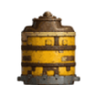 | **Generic Fuel Cell** | Economy | Fuel cell loaded into the vehicle tank. | 40 | Vendor staple | — |
|  | **Patch Kit** | Economy | Patch Kit consumed: restored vehicle condition. | 150 | Vendor staple | 75–150% (cap 175%) |
| 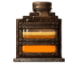 | **Field Patch Kit** | Economy | Field Patch Kit consumed: restored vehicle condition. | 400 | Crafter-only | 75–140% (cap 175%) |
| 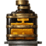 | **Master Patch Kit** | Economy | Master Patch Kit consumed: restored vehicle condition. | 1200 | Crafter-only | 80–160% (cap 175%) |
| 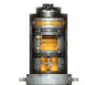 | **Fuel Cell** | Economy | Fuel cell loaded into the vehicle tank. | 120 | Crafter-only | 75–150% (cap 175%) |
|  | **Calibration Core** | Economy | Calibration Core consumed: shield recalibration work applied. | 900 | Crafter-only | 75–150% (cap 175%) |
|  | **Redline Tonic** | Corrupted | Redline Tonic consumed: sustained damage up. | 900 | Crafter-only | 70–150% (cap 175%) |
| 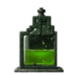 | **Heartwood Sight Oil** | Tactical | Heartwood Sight Oil consumed: crit focus sharpened. | 750 | Crafter-only | 75–150% (cap 175%) |
|  | **Forgeheart Charge** | Ordnance | Forgeheart Charge consumed: heavy ordnance primed. | 650 | Crafter-only | 70–150% (cap 175%) |
|  | **Prism Coating** | Ammo | Prism Coating consumed: rounds coated in elemental grit. | 800 | Crafter-only | 75–150% (cap 175%) |
|  | **ThrowTech Decoy Kit** | Tactical | ThrowTech Decoy Kit deployed: fire drawn off the hunter. | 700 | Crafter-only | 75–150% (cap 175%) |
|  | **Helix Calibration Kit** | Economy | Helix Calibration Kit consumed: loot rolls calibrated. | 500 | Crafter-only | 75–150% (cap 175%) |
| 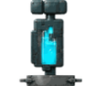 | **Overclock Serum** | Corrupted | Overclock Serum consumed: attack speed up for a minute. | 400 | Crafter-only | 70–150% (cap 175%) |
<!-- /wiki-gen:consumables -->

---

_Source of truth: `src/constants/consumables.ts` — rendered by `scripts/wiki-gen/`. Last synced from the repo `wiki/` directory — see `.sync-sha` for the master commit this page was published from._
