# Reference — Legendary Effects

Every legendary effect in the game, with the exact text the game
prints for it and an honest account of how it is implemented. See
[[Legendary Effects]] for how effects are hunted and why the status
column matters.

**How to read the Status column.** *Fully live* means the mechanic
does exactly what the text says in the real game systems. *Simulated
proxy* means the described mechanic depends on a system the boss
engine doesn't have (per-hit chains, charge refunds, DoT stacks), so
the boss simulator approximates its value as a flat combat bonus —
the weapon is genuinely stronger in boss fights, just by the
approximation. *Partial* means part of the text is wired exactly and
part has no counterpart yet.

**A note on sources.** The effect definitions mark eight effects as
eligible to roll on cache-forged weapons. In the shipped game, no
forging path actually assigns an effect — cache-forged weapons never
carry one, and boss drops are the only live source. The table prints
the eligibility data as it stands in the definitions; this note
prints the shipped behavior.

**A note on weapon types.** Every effect's bespoke art depicts one
specific weapon type, and a legendary carrying the effect always
drops as that type — the **Weapon type** column below is the frame
each effect lives on. Manufacturer, element, parts, and affixes
still roll freely. Legendaries already in inventories keep the type
they originally rolled; the rule governs new drops.

**The plates.** The **Plate** column shows each weapon's bespoke
art, generated from the game's own sprites by the wiki generator —
the same art, resolved the same way the game resolves it, so a plate
can never picture the wrong gun. The table closes with Emberfall,
the one named legendary that has art but no effect; its row says so
rather than inventing stats for it.

<!-- GENERATED from src/constants/legendaryEffects.ts, src/lib/legendaryEffects.ts, src/lib/pixel/manifest.ts, src/test/legendaryParityTable.ts — do not edit by hand -->
<!-- wiki-gen:legendary-effects -->
| Plate | Effect | What it does | Weapon type | Source | Min boss tier | Status |
| --- | --- | --- | --- | --- | --- | --- |
| 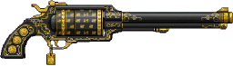 | **Debt Collector** | Each failed attempt vs. the same boss grants +3% win chance next time, stacking to a cap of +30%. | Pistol | Boss Drop | 1 | Fully live |
| 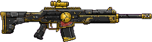 | **Warranty Void** | Each failed boss attempt permanently increases this weapon's base damage by +2%, up to +20%. | SMG | Boss Drop | 1 | Fully live |
| 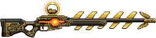 | **Ricochet Gospel** | Crits bounce to an additional target. Against a single boss, the bounce returns 40% damage. | Sniper | Boss Drop | 1 | Fully live |
| 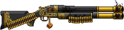 | **Bad Decision** | Win chance estimate is hidden, but victory reward multiplier is +25%. | Shotgun | Boss Drop | 1 | Fully live |
| 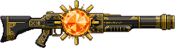 | **Glass Sun** | +50% Fire damage, but -30% Shield effectiveness. | SMG | Boss Drop | 1 | Fully live |
| 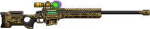 | **The Accountant** | Every 100 enemies defeated increases the rarity roll tier of your next drop by +1 stage. | Sniper | Boss Drop | 1 | Simulated proxy |
| 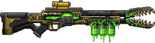 | **Armor Eater** | Corrosive procs reduce boss repair/healing by 50% and grant +20% armor break contribution. | Sniper | Boss Drop | 1 | Partial |
| 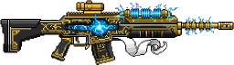 | **Thunder Receipt** | A Shock proc that breaks a shield refunds one Ordnance charge or 10% Action Skill charge. | Sniper | Boss Drop | 1 | Simulated proxy |
| 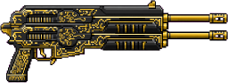 | **Second Opinion** | On boss victory, the loot roll happens twice. You keep the stronger weapon; the other is auto-scrapped. | Pistol | Boss Drop | 4 | Fully live |
| 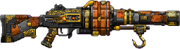 | **Salvage Rights** | Kills with this weapon yield +50% scrap. | Launcher | Boss Drop | 4 | Fully live |
| 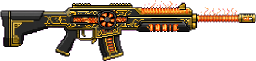 | **Overclocked** | Attack speed ramps +5% every 5 seconds during a fight, but crit chance drops -2% per ramp. | SMG | Boss Drop | 4 | Simulated proxy |
| 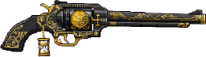 | **Borrowed Time** | Once per boss attempt, if you would fail the Survival Check, auto-consume 1 Med Kit and pass instead. | Pistol | Boss Drop | 4 | Simulated proxy |
| 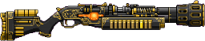 | **Kickback** | Every 7th hit deals 300% bonus damage as a burst spike. | Shotgun | Boss Drop | 4 | Fully live |
| 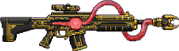 | **Vampiric Ledger** | Converts 5% of damage dealt into bonus credits on victory. | SMG | Boss Drop | 4 | Simulated proxy |
| 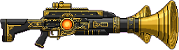 | **Echo Chamber** | Status effects applied by this weapon have a 30% chance to re-apply themselves once. | Launcher | Boss Drop | 4 | Fully live |
| 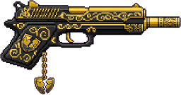 | **Insurance Fraud** | If equipped during a defeat, 50% of consumed consumables are refunded. | Pistol | Boss Drop | 4 | Fully live |
| 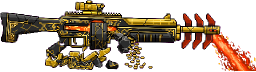 | **Market Crash** | This weapon's scrap value is 4x normal when recycled. | SMG | Boss Drop | 4 | Fully live |
| 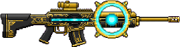 | **Stable Loop** | Action Skill charges 25% faster while this is your Primary weapon. | Beam | Boss Drop + Cache-Forged | 4 | Simulated proxy |
| 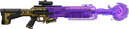 | **Phase Shifter** | First hit against each boss shield/armor phase ignores 40% of that layer. | Beam | Boss Drop + Cache-Forged | 4 | Simulated proxy |
| 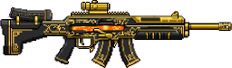 | **Hot Swapper** | Your Secondary weapon contributes 60% of its passive stats instead of the normal reduced rate. | SMG | Boss Drop + Cache-Forged | 4 | Fully live |
| 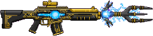 | **Chain Lightning** | Shock procs chain to up to 2 additional nearby targets (or back to the boss for reduced damage). | Beam | Boss Drop + Cache-Forged | 7 | Simulated proxy |
| 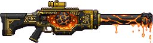 | **Molten Core** | Fire DoT stacks up to 5 times. Each stack reduces boss healing by an additional 10%. | Sniper | Boss Drop + Cache-Forged | 7 | Simulated proxy |
| 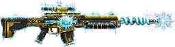 | **Cryo Stasis** | Cryo procs have a 20% chance to trigger a mini-stagger, interrupting the boss for +5% DPS window. | Beam | Boss Drop + Cache-Forged | 7 | Simulated proxy |
| 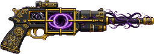 | **Void Bargain** | +40% Void damage, but every hit has a 5% chance to deal 10% damage to your own shield. | Pistol | Boss Drop + Cache-Forged | 7 | Partial |
| 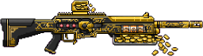 | **Jackpot** | Every 150th enemy killed by this weapon drops a Cache Key fragment. | SMG | Boss Drop + Cache-Forged | 7 | Fully live |
| 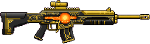 | **Emberfall** | Name-keyed proof art — no legendary effect carries this sprite. A weapon literally named Emberfall renders this art; it never rolls from an effect. | Sniper (as depicted) | — | — | Name-keyed art only |
<!-- /wiki-gen:legendary-effects -->

---

_Source of truth: `src/constants/legendaryEffects.ts`, `src/lib/legendaryEffects.ts` — rendered by `scripts/wiki-gen/`. Last synced from the repo `wiki/` directory — see `.sync-sha` for the master commit this page was published from._
