# Reference

This page is the wiki's data annex: CyberCache's complete numbers,
as tables.

## How these tables work

The tables here are **generated, not written**. Scripts under
`scripts/wiki-gen/` render them directly from the game's own content
definitions — the same constants the live game runs on — so a table
cannot quietly drift from the game the way a hand-copied list always
eventually does. A freshness check in CI (`npm run wiki:gen:check`)
fails if a published table ever falls behind the definitions it was
rendered from. If a number is in a Reference table, it is the number
the game shipped.

The biggest tables get their own pages:

- [[Reference-Legendary-Effects]] — all 25 effects with their honest
  implementation status.
- [[Reference-Consumables]] — the full consumables catalog.
- [[Reference-Recipes]] — every Workshop recipe with inputs and gates.
- [[Reference-Bosses]] — the 13-boss roster, intel only.
- [[Reference-Progression]] — skill-tree nodes and Cache Rank tracks.
- [[Reference-Collections]] — the 81 collection entries.

When a per-system page and a Reference table ever disagree, the table
wins: it is rendered from the game itself.

## Weapons & itemization

<!-- GENERATED from src/constants/weaponTypes.ts, src/constants/manufacturers.ts, src/constants/elements.ts, src/constants/rarities.ts — do not edit by hand -->
<!-- wiki-gen:weapons -->
### Weapon types

Base stats below are the frame every roll starts from, before manufacturer bias, rarity quality, and affixes.

| Type | Base DMG | Atk speed | Crit | Crit DMG | Status | Status DMG | Boss | Wave | Shield | Armor | Mag | Reload | Signature |
| --- | --- | --- | --- | --- | --- | --- | --- | --- | --- | --- | --- | --- | --- |
| **Pistol** | 80 | 1.2 | 10% | ×1.5 | 8% | ×1.2 | ×1 | ×1 | ×1 | ×1 | 15s | 1s | Sidearm Recovery |
| **SMG** | 45 | 2 | 8% | ×1.4 | 12% | ×1.1 | ×0.95 | ×1.15 | ×1.05 | ×0.9 | 10s | 2s | Overheat |
| **Shotgun** | 140 | 0.7 | 6% | ×1.6 | 10% | ×1.3 | ×0.9 | ×1.3 | ×0.95 | ×1.05 | 6s | 2.5s | Multi Proc |
| **Sniper** | 200 | 0.5 | 25% | ×2 | 5% | ×1 | ×1.2 | ×0.7 | ×1 | ×1.1 | 5s | 3s | Precision Window |
| **Launcher** | 300 | 0.35 | 3% | ×1.8 | 15% | ×1.5 | ×1.15 | ×1.1 | ×0.85 | ×1.3 | 2s | 4s | Reload Lock Stagger |
| **Beam** | 60 | 1.5 | 7% | ×1.35 | 20% | ×1.4 | ×1 | ×0.95 | ×1.15 | ×1.15 | 12s | 3s | Ramp Sustain |

### Manufacturers

| Manufacturer | Identity | Baked-in mechanic | Stat bias |
| --- | --- | --- | --- |
| **Redline** | Attack speed, ramping damage, sustained DPS | Attack speed +15% baked into every roll; its ramping damage is folded into base damage (+8%) | Attack Speed ×1.15, Base Damage ×0.95 |
| **Ironwood** | Crits, precision, boss killing | High crit chance/damage; strong single-target modifiers (+20% crit damage vs bosses) | Crit Chance ×1.2, Crit Damage ×1.25, Base Damage ×1.05 |
| **BlastForge** | Explosions, splash, stagger, armor cracking | Explosive damage helps armor break and boss phase checks (+25% armor damage) | Armor Damage ×1.25, Base Damage ×1.1, Attack Speed ×0.9 |
| **Prismatek** | Elemental specialization | Elemental specialization baked into every roll: +30% status chance and status damage, non-Kinetic elements favored | Status Chance ×1.3, Status Damage ×1.3, Base Damage ×0.95 |
| **ThrowTech** | Deployables and disposable tech | Deployable-tech frames: +20% wave damage baked into every roll | Wave Damage ×1.2, Base Damage ×0.9 |
| **HelixWorks** | Modular, flexible, better stat variance | Modular frames: +10 roll quality floor on every roll | Base Damage ×1 |

### Elements

A strong matchup deals ×1.3 damage; a weak one ×0.7 (from `getElementMatchup`, the same function the combat math reads).

| Element | Strong against | Weak against | Notes |
| --- | --- | --- | --- |
| **Kinetic** | — | — | Neutral. No major strength or weakness. Reliable baseline. |
| **Fire** | flesh, organic | shield, fire-resistant | Strong against flesh/organic. Applies burn DoT. Weak against shield-heavy. |
| **Shock** | shield | armor, shock-resistant | Strong against shields. Helps shield break checks. Weak against heavy armor. |
| **Corrosive** | armor, mechanical | flesh, shield | Strong against armor/mechanical. Helps armor break and anti-repair. |
| **Cryo** | fast, enrage | armor, cryo-resistant | Slows or staggers. Helps against fast bosses and enrage mechanics. |
| **Void** | elite, boss | consistent | High variance, curse, delayed burst. Powerful but less consistent. |

### Rarities

| Rarity | Affixes | Roll-quality bias | Special-effect chance | Scrap value | Drop weight (relative) |
| --- | --- | --- | --- | --- | --- |
| **Common** | 0–1 | +0 | — | ×1 | 60 |
| **Uncommon** | 1 | +5 | — | ×1.5 | 25 |
| **Rare** | 2 | +10 | 5% | ×2.5 | 10 |
| **Epic** | 3 | +15 | 15% | ×4 | 4 |
| **Legendary** | 4–5 | +20 | 100% | ×8 | 1 |
<!-- /wiki-gen:weapons -->

<!-- GENERATED from src/constants/weaponTypes.ts, src/constants/manufacturers.ts, src/lib/pixel/weaponCardCompositor.ts, src/lib/pixel/showcaseWeaponInput.ts — do not edit by hand -->
<!-- wiki-gen:weapon-frames -->
### Weapon frames, pictured

One representative Rare, Kinetic instance per type × manufacturer — frame and maker grammar are the variables; element and affixes are held neutral, and the seeds are fixed, so these are the same guns on every render. How the finished gun reads with an element lit is the next table.

| Type | Redline | Ironwood | BlastForge | Prismatek | ThrowTech | HelixWorks |
| --- | --- | --- | --- | --- | --- | --- |
| **Pistol** |  | 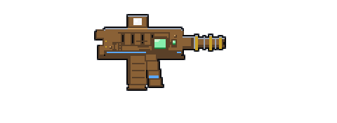 | 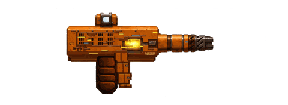 | 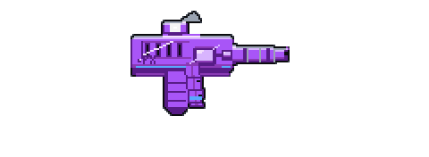 |  |  |
| **SMG** | 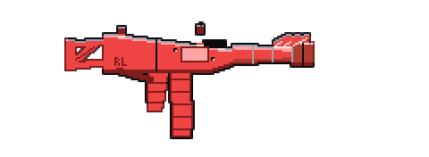 | 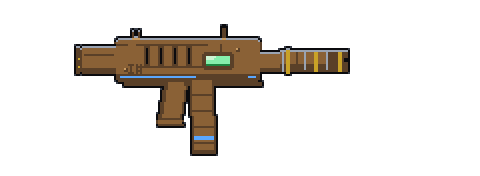 | 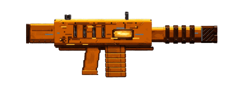 | 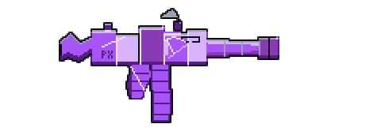 | 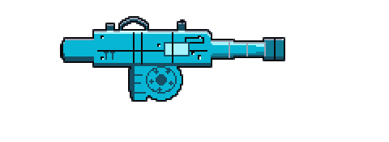 |  |
| **Shotgun** | 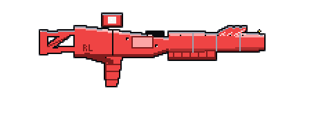 | 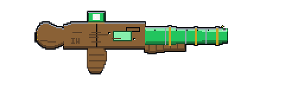 | 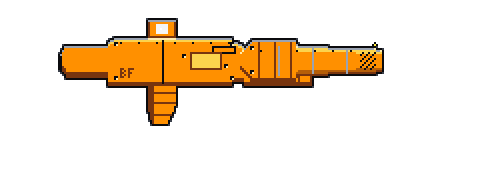 | 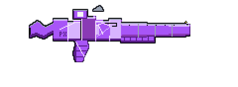 | 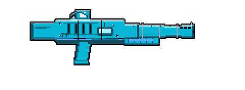 | 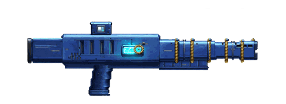 |
| **Sniper** | 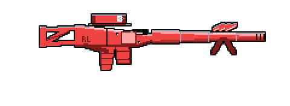 | 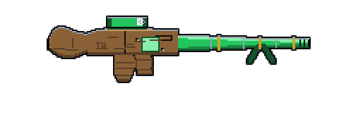 | 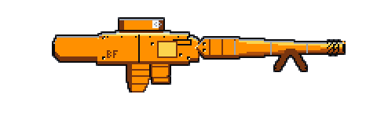 | 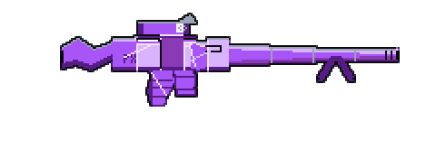 | 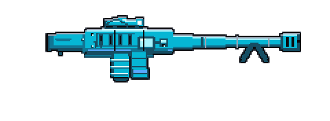 | 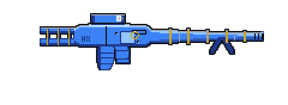 |
| **Launcher** | 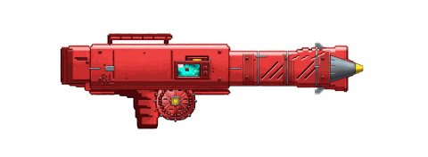 | 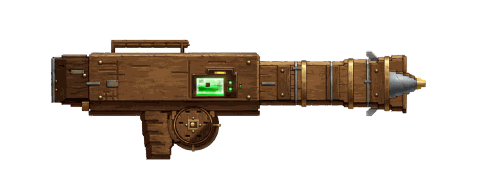 | 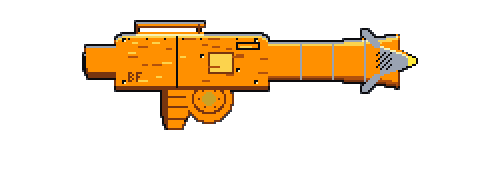 | 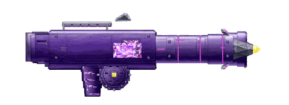 | 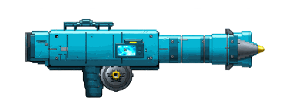 | 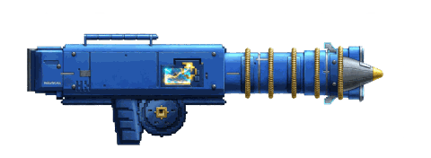 |
| **Beam** | 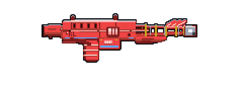 | 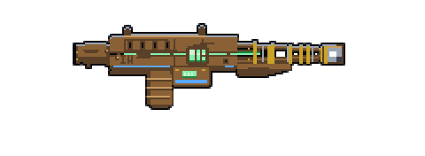 | 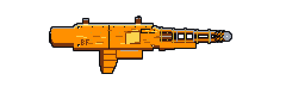 | 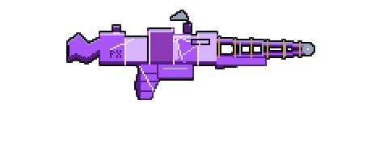 | 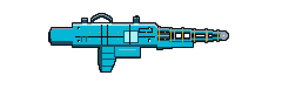 | 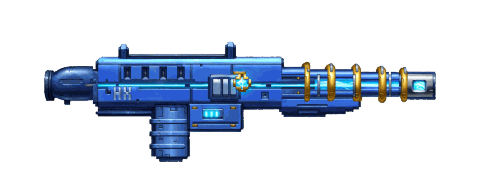 |
<!-- /wiki-gen:weapon-frames -->

<!-- GENERATED from src/constants/elements.ts, src/constants/weaponTypes.ts, src/constants/manufacturers.ts, src/lib/pixel/weaponCardCompositor.ts, src/lib/pixel/showcaseWeaponInput.ts — do not edit by hand -->
<!-- wiki-gen:weapon-elements -->
### Element reads, pictured

The same representative frame per type — same maker, same seed, Rare — re-rolled with each element. Only the element changes across a row: Kinetic is the honest unlit base, the other five light the frame's current in their own colorway.

| Type | Kinetic | Fire | Shock | Corrosive | Cryo | Void |
| --- | --- | --- | --- | --- | --- | --- |
| **Pistol** (Redline) |  |  |  |  |  |  |
| **SMG** (Ironwood) | 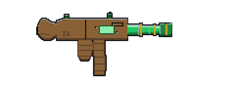 |  | 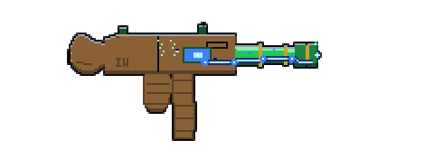 | 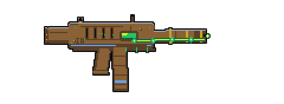 |  | 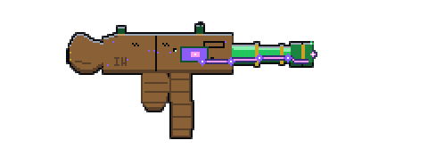 |
| **Shotgun** (BlastForge) |  | 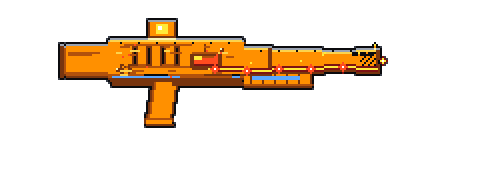 | 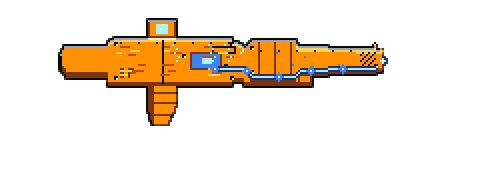 | 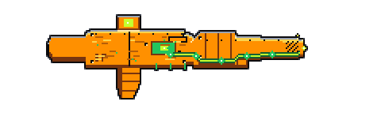 | 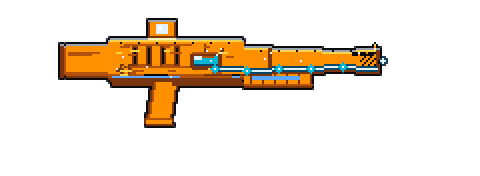 |  |
| **Sniper** (Prismatek) |  |  |  | 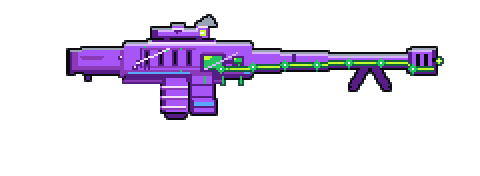 |  | 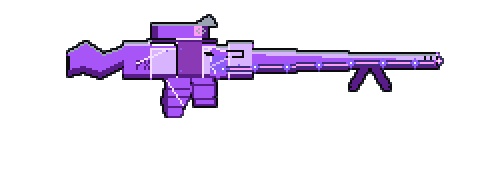 |
| **Launcher** (ThrowTech) | 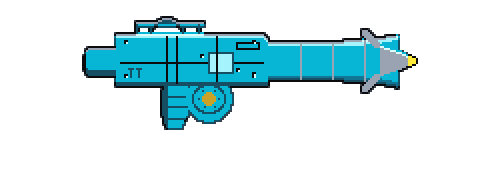 | 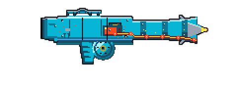 |  |  |  | 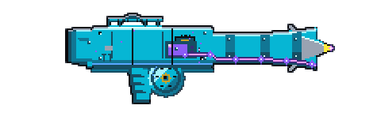 |
| **Beam** (HelixWorks) | 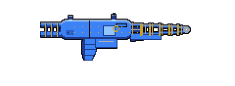 |  |  |  | 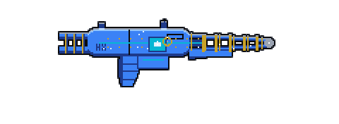 | 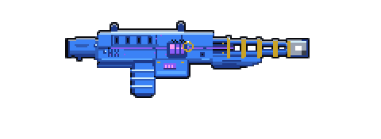 |
<!-- /wiki-gen:weapon-elements -->

## Affix pools

<!-- GENERATED from src/lib/gear/affixPools.ts — do not edit by hand -->
<!-- wiki-gen:affixes -->
Weapons roll from three sub-pools (combat, boss, idle); shields, ordnance, class mods, and relics each roll from their own pool. Ranges below are the roll ranges baked into an item when an affix lands.

#### Weapon — combat pool

| Affix roll | Stat |
| --- | --- |
| +3–12% Damage | baseDamage |
| +2–8% Crit Chance | critChance |
| +5–20% Crit Damage | critDamage |
| +3–10% Attack Speed | attackSpeed |
| +5–15% Boss Damage | bossDamageMod |
| +5–15% Wave Damage | waveDamageMod |

#### Weapon — boss pool

| Affix roll | Stat |
| --- | --- |
| +8–20% Shield Break | shieldDamageMod |
| +8–20% Armor Break | armorDamageMod |

#### Weapon — idle pool

| Affix roll | Stat |
| --- | --- |
| +5–15% Offline Earnings | offlineEarningsMod |
| +3–10% Rare Drop Chance | rareDropChanceMod |
| +5–20% Scrap Yield | scrapYieldMod |

#### Shield pool

| Affix roll | Stat |
| --- | --- |
| +5–15% Shield HP | hp |
| +5–15% Recharge Rate | rechargeRate |
| +3–10% Mitigation | mitigation |

#### Ordnance pool

| Affix roll | Stat |
| --- | --- |
| +5–15% Ordnance Damage | damage |
| +8–20% Shield Break | shieldDamage |
| +8–20% Armor Break | armorDamage |

#### Class mod pool

| Affix roll | Stat |
| --- | --- |
| +3–10% Weapon Damage | weaponDamage |
| +2–6% Crit Chance | critChance |
| +5–12% Boss Damage | bossDamageMod |
| +1–3 Bonus Skill Points | skillPoints |

#### Relic pool

| Affix roll | Stat | Category |
| --- | --- | --- |
| +8–20% Offline Earnings | offlineEarningsMod | idle |
| +5–15% Rare Drop Chance | rareDropChanceMod | idle |
| +8–25% Scrap Yield | scrapYieldMod | idle |
| +5–20% XP Gain | xpBoostMod | idle |
| +5–15% Cache Key Drop Rate | cacheKeyChanceMod | idle |
| +5–12% Boss Damage | bossDamageMod | boss |
| +5–15% Survival | survivalBoost | boss |
| +5–20% Consumable Efficiency | consumableEfficiency | skill |
<!-- /wiki-gen:affixes -->

## Gear, pictured

Every non-weapon gear kind, in the forms the game actually renders.
Weapons are pictured in the frames and element tables above; the
legendaries have their own page ([[Reference-Legendary-Effects]]).
See [[Gear]] for how the slots play.

<!-- GENERATED from src/lib/pixel/gearCardCompositor.ts, src/lib/pixel/shieldGrammar.ts, src/lib/pixel/ordnanceGrammar.ts, src/lib/pixel/classModGrammar.ts, src/lib/pixel/relicGrammar.ts, src/lib/combat/shieldBehaviors.ts — do not edit by hand -->
<!-- wiki-gen:gear-plates -->
### Shields

A shield's form IS its rolled behavior — the plate draws the device the behavior describes (see [[Shield-Tech]] for how behaviors roll). The body wears the shield's element colorway and the frame its rarity, so two shields with the same behavior share a silhouette and differ in color and trim. Plates are Rare shields with no affixes, composed by the game's own shield grammar.

| Plate | Behavior | Form | What it does |
| --- | --- | --- | --- |
| 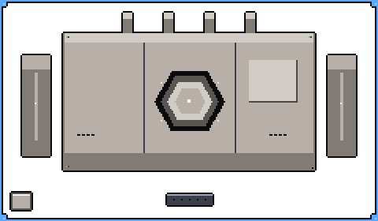 | **Standard** | balanced housing + top fins + hex emitter + side pods | No special behavior. |
| 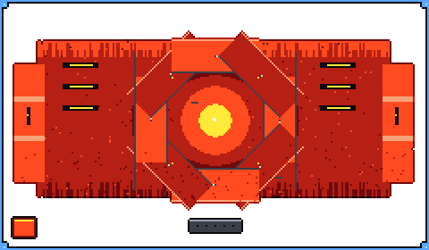 | **Nova** | shutter ring around a stepped core + vented back plate | When this shield breaks, it erupts in a burst of damage. |
|  | **Absorb** | concentric shell plates + orb + side shell stacks | Chance to fully absorb a hit and restore shield. |
|  | **Amp** | twin capacitor towers + coil console + bolt | Bonus damage while the shield is at full charge. |
|  | **Turtle** | wide riveted bulwark slab + segmented emitter slit | Oversized capacity, slow recharge. |

### Ordnance

Form follows the ordnance's rolled effect — the effect decides which device the item is. Plates are Rare ordnance with no affixes, composed by the game's own ordnance grammar.

| Plate | Form | Effects that wear it |
| --- | --- | --- |
|  | **Spike** | Fragmentation, Kinetic Slam |
|  | **Disc** | EMP Payload, Shockwave |
|  | **Seeker Dart** | Seeker, Void Tap |
|  | **Canister** | Cluster, Incendiary, Acid Burst, Cryo Shell |

### Class mods

Every tree gets its own plate: the device draws the tree's socket field, with the mod's boosted nodes lit in their sockets. Plates are Rare mods with their first two small nodes boosted, composed by the game's own class-mod grammar.

| Plate | Tree |
| --- | --- |
|  | **Gunslinger** |
|  | **Demolition** |
|  | **Scavenger** |
|  | **Fixer** |

### Relics

A relic's form follows its name — every named relic is its own device. The plinth under it is chosen by where the relic came from: a boss drop stands on a heavy totem foot, a cache-forged relic sits in a forge cradle, an event relic on a display stand, and a world drop on a plain field plinth. The plates all rest on the world plinth so the forms compare cleanly. Plates are Rare relics with no affixes, composed by the game's own relic grammar.

| Plate | Relic |
| --- | --- |
|  | **Vault Chip** |
|  | **Data Shard** |
|  | **Neural Key** |
|  | **Cache Relic** |
|  | **Echo Stone** |
|  | **Void Prism** |
|  | **Circuit Totem** |
|  | **Ancient Module** |
|  | **Scrap Core** |
|  | **Glitched Token** |
|  | **Ethereal Drive** |
|  | **Quantum Fragment** |
|  | **Precision Calipers** |
|  | **Servo Bench Rig** |
|  | **Reclaimer Head** |
|  | **Prime Laboratory** |
<!-- /wiki-gen:gear-plates -->

## Roaming areas

The same seven areas, pictured in their own paintings with their
signature loot and named elites: [[Reference-Areas]].

<!-- GENERATED from src/constants/roamingAreas.ts, src/constants/visualAssets.ts — do not edit by hand -->
<!-- wiki-gen:areas -->
Baseline rates are the area design rates before gear, skills, vehicles, and the hot-area rotation multiply them.

| Area | Danger | Enemies | Credits/min | Scrap/min | XP/tick | Material bias | Signature loot | Influence |
| --- | --- | --- | --- | --- | --- | --- | --- | --- |
| **Dustwaste Frontier** | Low | Raiders, scrap drones, and scavengers | 15 | 3 | 1 | Scrap, Ballistic Parts | Balanced gear, early salvage, cache fragments | Mixed |
| **Redline Circuit** | Medium | Fast raiders, pursuit drones, and overheating runners | 18 | 3 | 1.2 | Scrap, Ballistic Parts | SMGs, pistols, attack speed, reload and ramp affixes | Redline |
| **Ironwood Bastion** | Medium/High | Marksmen, armored captains, and sentry posts | 17 | 4 | 1.4 | Ballistic Parts, Tech | Snipers, pistols, crit rolls, weakpoint and boss-damage flavor | Ironwood |
| **BlastForge Yards** | Medium/High | Armored machines, refinery bots, and demolition crews | 16 | 5 | 1.65 | Scrap, Ballistic Parts, Reactive Components | Launchers, shotguns, armor break, stagger and explosive flavor | BlastForge |
| **Prismatek Reactor** | Variable | Elemental anomalies, shielded test subjects, and reactor constructs | 18 | 4 | 1.9 | Tech | Beams, elemental weapons, status affixes, weakness exploitation | Prismatek |
| **ThrowTech Dumpnet** | Medium | Hacked drones, turret nests, minefields, and signal traps | 19 | 4 | 2.15 | Tech, Reactive Components | Deployable-flavored gear, ordnance, utility drops, drone parts | ThrowTech |
| **HelixWorks Labyrinth** | High | Prototype constructs, unstable test rigs, and shifting lab defenses | 21 | 5 | 2.4 | Tech, Void Dust, Scrap, Reactive Components | HelixWorks gear, higher roll quality flavor, modular parts | HelixWorks |
<!-- /wiki-gen:areas -->

## Vehicles

<!-- GENERATED from src/lib/vehicles/vehicles.ts, src/lib/pixel/manifest.ts — do not edit by hand -->
<!-- wiki-gen:vehicles -->
### Vehicle classes

| Plate | Class | Ladder tier | Yield | Fuel / tick | Wear rate | Material bonus | Role |
| --- | --- | --- | --- | --- | --- | --- | --- |
|  | **Scrap Bike** | 1 | ×1.15 | 0.9 | ×1.1 | — | Starter mobility. |
|  | **Dune Buggy** | 8 | ×1.35 | 1.1 | ×1 | — | General roaming travel. |
|  | **Utility Rover** | 18 | ×1.25 | 0.7 | ×0.7 | — | Best fuel efficiency, slow wear — the long-haul farmer. |
|  | **Cargo Hauler** | 28 | ×1.1 | 1.3 | ×0.95 | +30% | Material farming support: lower raw yield, bonus material quantity. |
|  | **Armored Crawler** | 42 | ×1.05 | 1.5 | ×0.25 | — | Dangerous-zone reliability: near-negligible wear. |
|  | **Relay Skimmer** | 60 | ×1.6 | 2 | ×1.25 | — | Fastest yield, highest fuel burn, fragile. |
|  | **Leviathan Rig** | 75 | ×1.5 | 1.6 | ×0.5 | +15% | Endgame flagship: near-Skimmer yield, Crawler-grade endurance, a working cargo rack. |

The ladder tier is design data only (drop weighting, dispatch courier bands) — **no class has a level requirement**: vehicles are market goods, and if you can buy it, you can drive it.

### The model in numbers

- One fuel cell loads **100 fuel units** into the tank.
- Condition decays **0.02 points per fueled tick** before the class wear rate and area danger scaling:

| Area danger | Decay scaling |
| --- | --- |
| Low | ×0.6 |
| Medium | ×1 |
| Medium/High | ×1.3 |
| Variable | ×1.1 |
| High | ×1.6 |

- Patch kits restore condition at 100% quality: PatchKit **30** · FieldPatchKit **45** · MasterPatchKit **80**.
- Vehicles arrive as gear drops: **4%** of gear drops are replaced by a vehicle drop.

### Vehicle affix pool

| Affix roll | Stat |
| --- | --- |
| +4–10% Vehicle Yield | vehicleYieldPct |
| +5–15% Fuel Efficiency | vehicleFuelEfficiencyPct |
| +10–30% Reinforced Frame | vehicleFramePct |
| +8–20% Cargo Racks | vehicleCargoPct |
| +5–15% Scanner (find) | vehicleScannerPct |

### Affix & wear overlays, pictured

The Garage and the Home diorama draw these over the class sprite above: an overlay for the affix a vehicle rolled, and wear marks as its condition falls. Two plates ship in the game's art library ahead of their overlays — the table says which.

| Plate | Overlay | Drawn when |
| --- | --- | --- |
|  | **Cargo Rack** | A Cargo Racks affix is fitted |
|  | **Reinforced Frame** | A Reinforced Frame affix is fitted |
|  | **Scanner Array** | A Scanner affix is fitted |
|  | **Armor Plate** | Ships in the art library — no affix overlay draws it yet |
|  | **Condition Scuff** | Condition drops under 35% |
|  | **Condition Smoke** | Ships in the art library — no wear overlay draws it yet |
<!-- /wiki-gen:vehicles -->

---

_Source of truth: `src/content/`, `src/constants/`, `src/lib/` — rendered by `scripts/wiki-gen/`. Last synced from the repo `wiki/` directory — see `.sync-sha` for the master commit this page was published from._
