# Skins and Cosmetics

Your hunter's look is gear too — it just refuses to carry a single
stat. **Skin parts** are crafted items that replace pieces of your
hunter's standard-issue frame: a helm, a torso, arms, legs, a back
rig. They are **pure cosmetic — zero stats** — and they show
everywhere your hunter does: the Home stage, boss fights, the
Workshop bays, your Hunter profile showcase, and [[Leaderboards
and Streaks|Standings]], where every hunter renders wearing their
own parts.

## How you get parts: the Workshop

There are no blueprints, no drops, and no cache-box tie-in. Every
skin recipe simply **appears in [[Crafting]]** (Workshop → **Skin
Parts** lane) and is paid for mostly in **Scrap** — the same salvage
currency that drops everywhere — plus a few materials per part.
Skin recipes carry **no level requirement**: the bench tier and
the scrap are the whole gate.
Crafting a part is a normal timed Workshop job: it advances only
while crafting is your active action, and it pays into its own
**Cosmetic Crafting** mastery (15 XP per part), which widens the
finish roll below.

Wave 1 ships **26 parts** in three tiers:

- **Bulwark (shaped, tier 3)** — a full 10-part set with its own
  silhouette: oversized helm, siege torso, Stomper legs. Bench 3,
  one part per job, 105–210 minutes each. Scrap runs
  1,800–3,600 per part (25,200 for the whole set) plus refined
  materials and composites.
- **Dreadplate (repaint, tier 2)** — the standard frame re-forged
  in dread colors, all 10 parts. Bench 2, up to 10 per
  job, 45 minutes each, 600–700 Scrap per part (6,100 the set)
  plus one or two materials.
- **Manufacturer heads** — the six makers' heads (Redline,
  Ironwood, BlastForge, Prismatek, ThrowTech, HelixWorks) are in
  the normal pool like everything else: bench 2, 1,800
  Scrap + 2 of the maker's signature material, 90 minutes.

Every slot is covered from day one: head, torso, both arms
(upper + forearm near, far arm), both legs (thigh + lower leg —
the boot is part of the lower leg), and back. Everything is
permanently available; there are no limited-time windows yet.

<!-- GENERATED from src/content/skins.ts, src/lib/pixel/skinParts.ts, src/lib/pixel/partsCompositor.ts, src/lib/pixel/standardIssue.ts — do not edit by hand -->
<!-- wiki-gen:skins-pictured -->
## The wave-1 sets, pictured

Every part below is pictured twice over: the part itself, and — for the two full sets — the hunter wearing the whole set, rendered by the game's own parts compositor with the parts replacing the standard frame. Renders are untinted at Standard finish, the catalog look; your own finish roll and tint re-light the same shapes (see *The finish roll* and *Tinting and Chromaweave* below).

### Bulwark

Heavy plate, shaped new: an oversized helm, a siege torso, and Stomper legs. The silhouette is the statement.

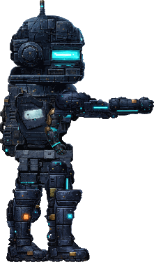

| Plate | Part | Slot |
| --- | --- | --- |
| 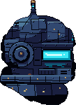 | **Bulwark Helm** | Head |
| 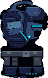 | **Bulwark Siege Torso** | Torso |
| 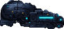 | **Bulwark Pauldron Arm** | Upper arm (near) |
| 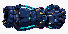 | **Bulwark Gauntlet** | Forearm (near) |
| 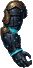 | **Bulwark Support Arm** | Far arm |
| 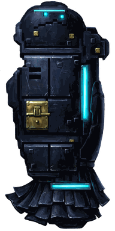 | **Bulwark Thigh (Near)** | Thigh (near) |
| 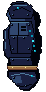 | **Bulwark Thigh (Far)** | Thigh (far) |
| 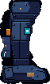 | **Stomper Leg (Near)** | Lower leg + boot (near) |
| 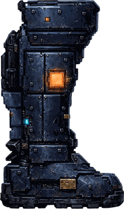 | **Stomper Leg (Far)** | Lower leg + boot (far) |
| 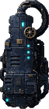 | **Packmaster Tank** | Back |

### Dreadplate

Standard Issue silhouettes repainted in bone plate and crimson trim, with a red visor glow.

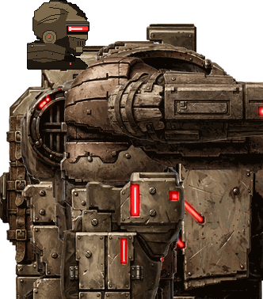

| Plate | Part | Slot |
| --- | --- | --- |
| 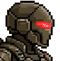 | **Dreadplate Helm** | Head |
| 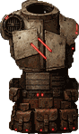 | **Dreadplate Torso** | Torso |
| 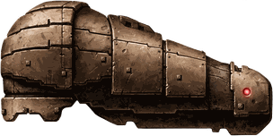 | **Dreadplate Upper Arm** | Upper arm (near) |
| 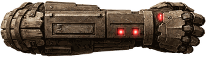 | **Dreadplate Forearm** | Forearm (near) |
| 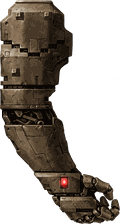 | **Dreadplate Support Arm** | Far arm |
| 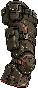 | **Dreadplate Thigh (Near)** | Thigh (near) |
| 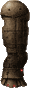 | **Dreadplate Thigh (Far)** | Thigh (far) |
| 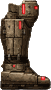 | **Dreadplate Lower Leg (Near)** | Lower leg + boot (near) |
| 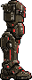 | **Dreadplate Lower Leg (Far)** | Lower leg + boot (far) |
| 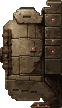 | **Dreadplate Back Rig** | Back |

### Manufacturer Heads

The six manufacturer helmets, crafted like everything else. Standing-earned heads stay wearable.

The heads are single parts, so each is shown worn on the standard frame — the second column is the first column on a hunter.

| Plate | Worn | Helm | Maker |
| --- | --- | --- | --- |
| 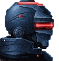 | 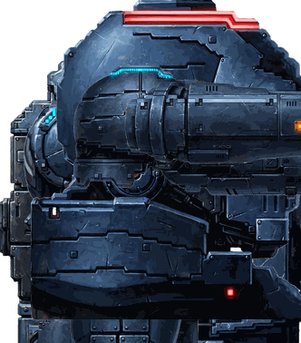 | **Redline Helm** | Redline |
| 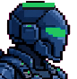 | 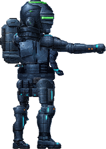 | **Ironwood Helm** | Ironwood |
| 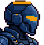 | 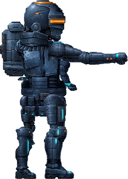 | **BlastForge Helm** | BlastForge |
| 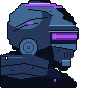 | 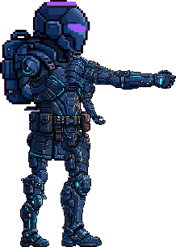 | **Prismatek Helm** | Prismatek |
| 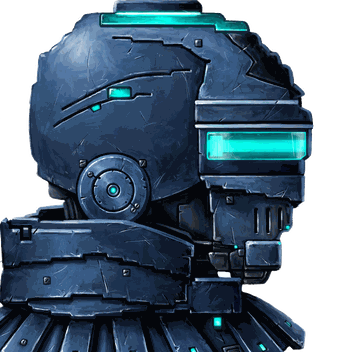 | 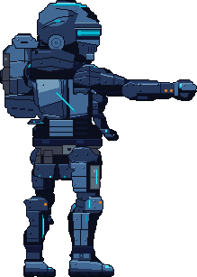 | **ThrowTech Helm** | ThrowTech |
| 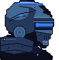 | 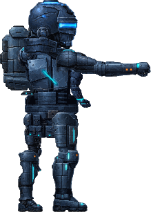 | **HelixWorks Helm** | HelixWorks |
<!-- /wiki-gen:skins-pictured -->

## The finish roll

A crafted part carries a **quality %** — its *finish*. The roll
works like consumable quality: your bench and your Cosmetic
Crafting mastery raise the ceiling. The finish names itself:

- **Worn** — under 55%. Duller, desaturated.
- **Standard** — 55–84%. The part as designed.
- **Pristine** — 85%+. Richer color, stronger accent.

Finish is looks only. A Worn Bulwark helm and a Pristine one are
the same item wearing different light.

## Wearing parts: the Wardrobe

The **Wardrobe** lives on your Hunter profile: a showcase stage
with your hunter wearing his current look (weapon included), your
owned parts by slot, and the full craftable catalog with its
costs. A shortcut door also sits on the figure stage of the Gear
tab's Loadout page — it lands here, on the Wardrobe panel. Tap **Wear** and the part replaces the stock piece for that
slot — parts replace, they never layer over the stock frame. One
part per slot; equipping a second part for a slot swaps the first
back to your inventory.

The **head pick** works alongside parts: the four free head
variants (Visor, Optic, Hood, Fin) apply whenever no head *part*
is worn. Manufacturer heads earned through [[Manufacturer
Standing]] (rank 3 on a maker's ladder) stay wearable as picks
forever — earning one is never revoked — and the same heads can
also be crafted as parts and worn as items. A worn head part
overrides the pick while it's on.

## Tinting and Chromaweave

Any owned part can be **tinted** at the Workshop's Tinting lane:
a 5-minute job costing a flat **25 Scrap** plus the palette's
**Chromaweave**. Seven palettes ship in wave 1:

- **Arctic** and **Void** are *starter* tints — no Chromaweave,
  so a new player can personalize on day one.
- **Crimson, Verdant, Solar, Abyss,** and **Royal** cost
  **1 Chromaweave** each.

Chromaweave itself is a refined material: the **Chromaweave
Weave** recipe (Refining lane) turns 2 Myco-Steel Fiber + 1 Void
Essence into 2 Chromaweave (30 minutes, bench 2 furnace), and it
trades on [[The Market]] like every other material. Short on
Chromaweave at the bench, the Tinting lane's holdings line carries
the quick-buy **+** — it opens the [[Crafting|quick-buy sheet]]
priced for exactly the gap, so the tint in front of you never waits
on a Market trip. (The tint's Scrap half never carries a **+** —
Scrap is earned, not bought.) A tint
replaces the part's previous tint; a part being tinted can't be
listed for sale until the job lands.

## Trading parts

Parts are ordinary inventory: **sellable and tradeable on [[The
Market]]** under the Skin Parts category, at the standard 5% fee,
with price history tracked per part design. The listing card shows
the part worn on a hunter, its finish, and its tint — what you see
is the exact item. Rules that keep the market honest:

- Listing a part you're **wearing** takes it off your hunter in
  the same motion — a listed part is never still on a hunter.
- **Locked** parts can't be listed; unlock first.
- A part **mid-tint** can't be listed until the tint lands.
- Buying a part puts it in your inventory, ready to wear from the
  Wardrobe.

Parts can also be salvaged like other items if you truly never
want to see one again — but the market usually pays better than
the recycler.
