# Skins and Cosmetics

Your hunter's look is gear too — it just refuses to carry a single
stat. Each of the four Cache Hunters is **one painting**, and a
**skin** is a whole replacement painting for that hunter — worn
whole, never in pieces, and **pure cosmetic — zero stats**.

## Whole skins: the Wardrobe

Open **Hunter → Wardrobe** to see your fielded hunter's painting
and their skins. Every hunter starts with their **Standard Issue**
skin — the painting itself:

- **Vesper Cole** — the cache-touched gunslinger: outlaw brim,
  cache-energy arm (plum).
- **Silas Boone** — living ordnance: a torso fused with a bomb
  casing (hazard rust-orange).
- **Josie Lode** — a non-humanoid salvage machine: storage-bin
  body, lamp eye-stalk (teal).
- **Doc Sutter** — a walking workshop: furnace-forge chest,
  welding-mask faceplate (dusty steel-blue).

**Wear** seats a skin; **Remove** returns the hunter to their base
painting. The wardrobe prints worn and owned counts for the fielded
hunter. A skin belongs to exactly one hunter — Vesper's skin never
fits Silas — and wearing one changes **no stat, ever**: a skin is
paint, not power. Whole skins are items: they craft in the
Workshop's cosmetic lane (a complete skin, never a fragment), they
come from set conversion (below), and they trade on [[The Market]]
under their own **Skins** category.

## Skin parts: the legacy system

**Skin parts** are crafted items that once replaced pieces of a
hunter's standard-issue frame: a helm, a torso, arms, legs, a back
rig. They are **no longer worn** — the Wardrobe fits whole skins
now — so parts stand as **collection pieces**: they stay in your
[[Collections]], and nothing you own is deleted by the change.
Part crafting has **ended**: the part recipes have left the
Workshop, and no new part listings can be created (a listing that
was already live still completes for its buyer).

**Set conversion.** Owning **every part of a set** converts that
set into the set's **whole skin** — one skin per hunter the set
has been painted for. The parts are **not consumed**: they stay
yours as collection pieces, and the skin arrives on its own. A
partial set converts nothing. Conversion is checked whenever your
cosmetics are read, so a set completed by a trade converts on
your next look. No wave-1 set has a whole painting yet — Bulwark
and Dreadplate were never painted as wholes — so conversion
stands ready and grants nothing until the first set painting
ships.

## How you get parts: the Workshop

There are no blueprints, no drops, and no cache-box tie-in. Every
skin recipe simply **appears in [[Crafting]]** (Workshop → **Skin
Parts** lane) and is paid for mostly in **Scrap** — the same salvage
currency that drops everywhere — plus a few materials per part.
Short on Scrap? It is a material like any other, so it trades on
[[The Market]] — buy the stack instead of grinding for it.
Skin recipes carry **no level requirement**: the bench tier and
the scrap are the whole gate.
Crafting a part is a normal timed Workshop job: it advances only
while crafting is your active action, and it pays into its own
**Cosmetic Crafting** mastery (15 XP per part), which widens the
finish roll below.

**That was the wave-1 shape. The lane has turned over:** the part
recipes are retired, and the cosmetic lane now belongs to **whole
skins** — a whole-skin recipe crafts one complete skin for its
hunter, paid mostly in Scrap like the parts were, under the same
finish roll. The lane stands empty until the first painted set
ships its recipe; **tinting** owned parts (below) is unchanged.

Wave 1 ships **26 parts** in three tiers:

- **Bulwark (shaped, tier 3)** — a full 10-part set with its own
  silhouette: oversized helm, siege torso, Stomper legs. Bench 3,
  one part per job, 105–210 minutes each. Scrap runs
  1,800–3,600 per part (25,200 for the whole set) plus refined
  materials and composites.
- **Dreadplate (repaint, tier 2)** — the standard frame re-forged
  in dread colors, all 10 parts. Bench 2, up to 10 per
  job, 45 minutes each, 600–700 Scrap per part (6,100 the set)
  plus one or two materials.
- **Manufacturer heads** — the six makers' heads (Redline,
  Ironwood, BlastForge, Prismatek, ThrowTech, HelixWorks) are
  **retired from the craft pool**: the look now lives in one
  lane, the [[Manufacturer Standing]] rank-3 head pick (below).
  No new copies can be crafted, and the helms can't be newly
  listed for sale. Copies crafted before the retirement are
  grandfathered absolutely — they remain yours as collection
  pieces, and a listing that was already live trades as normal.
  The same retirement now covers Bulwark and Dreadplate too.

Every slot is covered from day one: head, torso, both arms
(upper + forearm near, far arm), both legs (thigh + lower leg —
the boot is part of the lower leg), and back. Everything else is
permanently available; there are no limited-time windows yet.

The hunter is drawn in strict side view, so in the combat
stances — aiming and riding out the recoil — the far arm is not
drawn at all: only the gun arm shows. Your shield does not sit
those stances out: it remounts to your torso, held across the
body, for exactly as long as the far arm is away, and it is back
on the arm at rest. This holds on every set — standard-issue,
Bulwark, and Dreadplate alike.

<!-- GENERATED from src/content/skins.ts, src/lib/pixel/skinParts.ts, src/lib/pixel/partsCompositor.ts, src/lib/pixel/standardIssue.ts — do not edit by hand -->
<!-- wiki-gen:skins-pictured -->
## The wave-1 sets, pictured

Every part below is pictured twice over: the part itself, and — for the two full sets — the hunter wearing the whole set, rendered by the game's own parts compositor with the parts replacing the standard frame. Renders are untinted at Standard finish, the catalog look; your own finish roll and tint re-light the same shapes (see *The finish roll* and *Tinting and Chromaweave* below).

### Bulwark

Heavy plate, shaped new: an oversized helm, a siege torso, and Stomper legs. The silhouette is the statement.

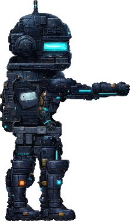

| Plate | Part | Slot |
| --- | --- | --- |
| 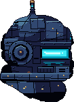 | **Bulwark Helm** | Head |
| 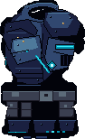 | **Bulwark Siege Torso** | Torso |
| 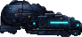 | **Bulwark Pauldron Arm** | Upper arm (near) |
| 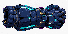 | **Bulwark Gauntlet** | Forearm (near) |
| 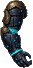 | **Bulwark Support Arm** | Far arm |
| 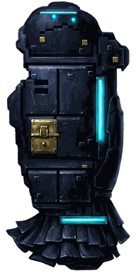 | **Bulwark Thigh (Near)** | Thigh (near) |
| 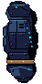 | **Bulwark Thigh (Far)** | Thigh (far) |
| 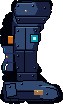 | **Stomper Leg (Near)** | Lower leg + boot (near) |
| 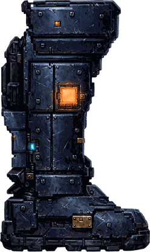 | **Stomper Leg (Far)** | Lower leg + boot (far) |
| 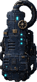 | **Packmaster Tank** | Back |

### Dreadplate

Standard Issue silhouettes repainted in bone plate and crimson trim, with a red visor glow.

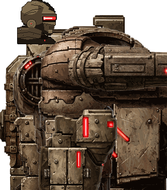

| Plate | Part | Slot |
| --- | --- | --- |
| 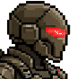 | **Dreadplate Helm** | Head |
| 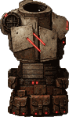 | **Dreadplate Torso** | Torso |
| 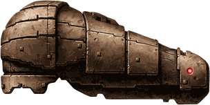 | **Dreadplate Upper Arm** | Upper arm (near) |
| 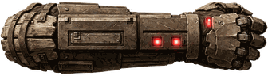 | **Dreadplate Forearm** | Forearm (near) |
| 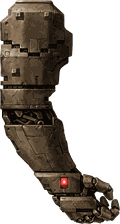 | **Dreadplate Support Arm** | Far arm |
| 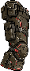 | **Dreadplate Thigh (Near)** | Thigh (near) |
| 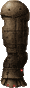 | **Dreadplate Thigh (Far)** | Thigh (far) |
| 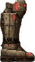 | **Dreadplate Lower Leg (Near)** | Lower leg + boot (near) |
| 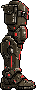 | **Dreadplate Lower Leg (Far)** | Lower leg + boot (far) |
| 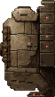 | **Dreadplate Back Rig** | Back |

### Manufacturer Heads

The six maker helmets now live in one lane: the Standing rank-3 head pick, earned at the Rep Desk. Crafted copies from the old pool are retired — no new crafts, no new listings — and copies already owned wear forever.

The heads are single parts, so each is shown worn on the standard frame — the second column is the first column on a hunter.

| Plate | Worn | Helm | Maker |
| --- | --- | --- | --- |
| 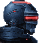 | 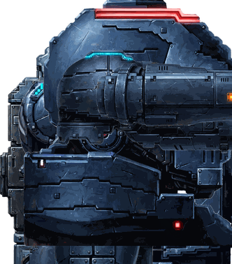 | **Redline Helm** | Redline |
| 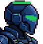 | 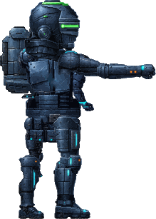 | **Ironwood Helm** | Ironwood |
| 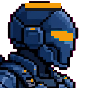 | 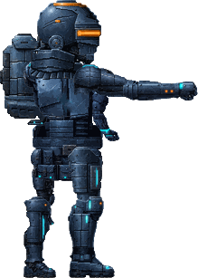 | **BlastForge Helm** | BlastForge |
| 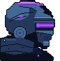 | 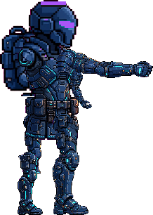 | **Prismatek Helm** | Prismatek |
| 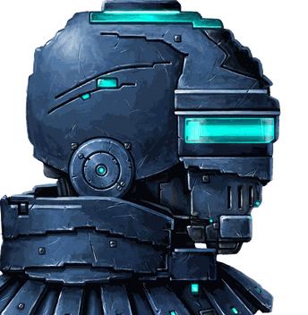 | 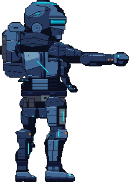 | **ThrowTech Helm** | ThrowTech |
| 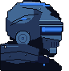 | 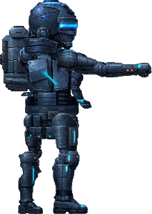 | **HelixWorks Helm** | HelixWorks |
<!-- /wiki-gen:skins-pictured -->

## The finish roll

A crafted part carries a **quality %** — its *finish*. The roll
works like consumable quality: your bench and your Cosmetic
Crafting mastery raise the ceiling. The finish names itself:

- **Worn** — under 55%. Duller, desaturated.
- **Standard** — 55–84%. The part as designed.
- **Pristine** — 85%+. Richer color, stronger accent.

Finish is looks only. A Worn Bulwark helm and a Pristine one are
the same item wearing different light.

## Wearing parts: the Wardrobe

The **Wardrobe** has its own stop on the Hunter tab, behind the
Wardrobe door at the foot of the Hunter menu: a showcase stage
with your hunter wearing his current look (weapon included), your
owned parts by slot, and the full craftable catalog with its
costs. The weapon on that stage — and on every stage — is the
item's own full-detail drawing, the same picture as its Gear
card with the display furniture folded away (see [[Gear]] § How
a weapon looks). Those costs are live: a part's Scrap price is tuned per
recipe (see [[Economy]]), and the Wardrobe always quotes the
price that will actually be charged. Each craftable row also
prints the part's real craft time beside its inputs — the same
duration the Workshop job will run. A shortcut door also sits on the figure stage of the Gear
tab's Loadout page — it lands here, on the Wardrobe panel. Tap **Wear** and the part replaces the stock piece for that
slot — parts replace, they never layer over the stock frame. One
part per slot; equipping a second part for a slot swaps the first
back to your inventory.

The **head pick** works alongside parts: the four free head
variants (Visor, Optic, Hood, Fin) apply whenever no head *part*
is worn. Manufacturer heads earned through [[Manufacturer
Standing]] (rank 3 on a maker's ladder) stay wearable as picks
forever — earning one is never revoked. Crafted helm *parts*
from before the retirement still exist and wear as items the
same way; no new ones can be crafted or listed. A worn head part
overrides the pick while it's on.

## How other hunters see you

On the public surfaces — the portrait beside your Standings rows
and the figure on your public profile — you appear as the Cache
Hunter you field, painted whole: the same painting that stands
on your Home stage. Worn parts no longer draw your figure
anywhere public; parts are collection pieces now, and a part for
sale shows the part itself.

## How the figure is jointed

Your hunter is assembled from his parts on a jointed rig every
time he appears — Wardrobe, Gear, and the Home stage all draw the
same figure from the same parts. The legs are jointed at the knee
now, the same way the arms have always been jointed at the elbow:
the shin hangs off the thigh's knee instead of being pinned to
the ground, so the legs can genuinely articulate. Every part
renders exactly as before — same pictures, same anchors, same
poses — the joint is groundwork for the hunter's stride, which
arrives with the travel beat it belongs to.

## Tinting and Chromaweave

Any owned part can be **tinted** at the Workshop's Tinting lane:
a 5-minute job costing a flat **25 Scrap** (the tint's standard
price — like every recipe's Scrap cost it is tuned live, and the
panel always shows the current price) plus the palette's
**Chromaweave**. Seven palettes ship in wave 1:

- **Arctic** and **Void** are *starter* tints — no Chromaweave,
  so a new player can personalize on day one.
- **Crimson, Verdant, Solar, Abyss,** and **Royal** cost
  **1 Chromaweave** each.

Chromaweave itself is a refined material: the **Chromaweave
Weave** recipe (Refining lane) turns 2 Myco-Steel Fiber + 1 Void
Essence into 2 Chromaweave (30 minutes, bench 2 furnace), and it
trades on [[The Market]] like every other material. Short on
Chromaweave at the bench, the Tinting lane's holdings line carries
the quick-buy **+** — it opens the [[Crafting|quick-buy sheet]]
priced for exactly the gap, so the tint in front of you never waits
on a Market trip. (The tint's Scrap half never carries a **+** —
Scrap is earned, not bought.) A tint
replaces the part's previous tint; a part being tinted can't be
listed for sale until the job lands.

## Trading parts

Parts traded on [[The Market]] under the Skin Parts category at
the standard 5% fee, with price history tracked per part design.
**New part listings have ended** — every part design is retired
now, not just the manufacturer helms. A part listing that was
already live still completes for its buyer as normal; owned parts
stay in your [[Collections]] either way.

**Whole skins are the tradeable cosmetics now.** A skin lists
under its own **Skins** category on [[The Market]], at the same
standard 5% fee, with price history tracked per skin. The listing
card shows the skin's painting, its hunter, and its finish. Rules
that keep the market honest:

- A skin fits **only its own hunter** — the card names the hunter,
  and the Wardrobe only offers skins you own for the hunter
  you're dressing.
- Listing a skin you're **wearing** is fine: if it sells, your
  hunter falls back to their Standard Issue painting until you
  pick another.
- **Locked** skins can't be listed; unlock first.
- Buying a skin puts it in your inventory, ready to wear from the
  Wardrobe on its hunter.

Parts can also be salvaged like other items if you truly never
want to see one again.
